# 01 Netzwerk und pfSense

Aufbau der drei Lab-Netze, pfSense als Gateway und Firewall-Regeln.

## 1. Netzwerkarchitektur

<!-- Diagramm einbinden, sobald es in diagrams/ liegt:

-->

### Netze und Interfaces

| Interface | Netz       | pfSense-IP      | DHCP-Bereich für die VMs |
| --------- | ---------- | --------------- | ------------------------ |
| WAN       | Heimnetz   | DHCP vom Router | -                        |
| LAN       | Management | 10.10.10.1      | .100 bis .200            |
| OPT1      | Opfer      | 10.10.20.1      | .100 bis .200            |
| OPT2      | Angreifer  | 10.10.30.1      | .100 bis .200            |

> [!NOTE]
> Die drei Lab-Netze sind in Proxmox eigene Bridges ohne Bridge-Port (vmbr1, vmbr2, vmbr3).
> Sie haben also keine Verbindung nach außen, der ganze Verkehr läuft über die pfSense.

### VMs im Netzwerk

| VM                       | Netz                 | IP                                                     |
| ------------------------ | -------------------- | ------------------------------------------------------ |
| pfSense                  | alle Netze (Gateway) | 192.168.X.54 (WAN), 10.10.10.1, 10.10.20.1, 10.10.30.1 |
| Wazuh                    | Management           | 10.10.10.10 (feste IP per DHCP Static Mapping)         |
| Windows 11 (win11-opfer) | Opfer                | DHCP                                                   |
| Linux (linux-opfer)      | Opfer                | 10.10.20.100                                           |
| Kali                     | Angreifer            | 10.10.30.100                                           |

## 2. pfSense einrichten 

### Grundeinrichtung in der pfSense-Konsole direkt nach der Installation

| Einstellung          | Wert                                                     |
| -------------------- | -------------------------------------------------------- |
| VLANs                | keine                                                    |
| Interfaces zuweisen  | WAN = vtnet0, LAN = vtnet1, OPT1 = vtnet2, OPT2 = vtnet3 |
| LAN-IP               | 10.10.10.1/24 (kein Gateway, kein IPv6)                  |
| DHCP auf LAN         | 10.10.10.100 bis 10.10.10.200                            |
| Webinterface         | bleibt bei HTTPS                                         |

Schritte für das LAN-Interface (Menüpunkt 2):

1. `Enter an option` → `2` (Set interface(s) IP address)
2. `Enter the number of the interface you wish to configure` → `2` (LAN)
3. `Configure IPv4 address LAN interface via DHCP?` → `n`
4. `Enter the new LAN IPv4 address` → `10.10.10.1`
5. `Enter the new LAN IPv4 subnet bit count` → `24`
6. `For a LAN, press <ENTER> for none` (Gateway) → Enter
7. `Configure IPv6 address LAN interface via DHCP6?` → `n`
8. `Enter the new LAN IPv6 address` → Enter (keine)
9. `Do you want to enable the DHCP server on LAN?` → `y`
10. `Enter the start address of the IPv4 client address range` → `10.10.10.100`
11. `Enter the end address of the IPv4 client address range` → `10.10.10.200`
12. `Do you want to revert to HTTP as the webConfigurator protocol?` → `n`
13. Enter zum Abschließen. Danach ist das Webinterface von pfSense unter `https://10.10.10.1` erreichbar.

> [!NOTE]
> Das wird für OPT1 (Opfer) und OPT2 (Angreifer) wiederholt, nur mit den jeweiligen IPs aus der Tabelle oben.

| Seite                         | Was du machst                                                                                                                                                              |
| ----------------------------- | -------------------------------------------------------------------------------------------------------------------------------------------------------------------------- |
| Welcome / Netgate Support     | einfach **Next**                                                                                                                                                           |
| General Information           | Hostname und Domain **nicht leer lassen** (Standardwerte reichen). Bei leeren Feldern stürzt später der DNS Resolver (unbound) ab. DNS-Server optional `1.1.1.1` eintragen |
| Time Server                   | Timezone auf **Europe/Berlin** stellen                                                                                                                                     |
| **Configure WAN Interface**   | Typ bleibt **DHCP**. Ganz nach unten scrollen und die Haken bei **„Block RFC1918 Private Networks“** und **„Block bogon networks“** rausnehmen                             |
| Configure LAN Interface       | steht schon auf `10.10.10.1` / `24`, einfach **Next**                                                                                                                      |
| **Set Admin WebGUI Password** | Hier unbedingt ein eigenes, sicheres Passwort setzen                                                                                                                       |
| Reload                        | **Reload** klicken, kurz warten, dann **Finish**                                                                                                                           |

falls man die Einstellungen  **„Block RFC1918 Private Networks“** und **„Block bogon networks“** noch nicht vorgenommen hat kann man die im nachhinein noch machen unter **Interface → WAN** nach ganz unten scrollen und die beiden Häkchen falls vorhanden rausnehmen und auf **Save** drücken.

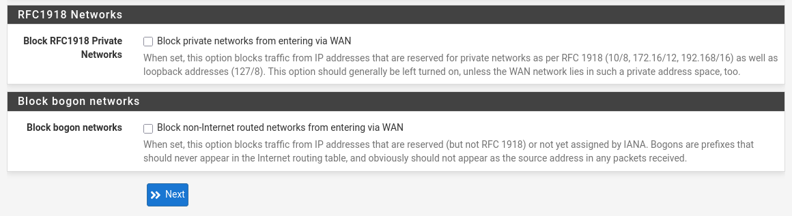

Warum die WAN-Haken raus müssen: Mein Heimnetz (192.168.X.0/24) ist selbst ein privates Netz. Mit „Block private networks“ blockt die pfSense also jeden Zugriff aus meinem Heimnetz auf ihr eigenes Webinterface.

### Zugriff aus dem Heimnetz aufs Webinterface

Um aus meinem Heimnetz mit meinem Computer auf die Weboberfläche zugreifen zu können, müssen ein paar Einstellungen gemacht werden. 

 In der pfSense-Konsole die Firewall kurz deaktivieren mit:
   ```
   pfctl -d
   ```
2. Die IP im Browser aufrufen
3. Unter **Firewall → Rules → WAN** auf **Add** klicken und eine Regel für 443 aus 192.168.X.0/24 anlegen
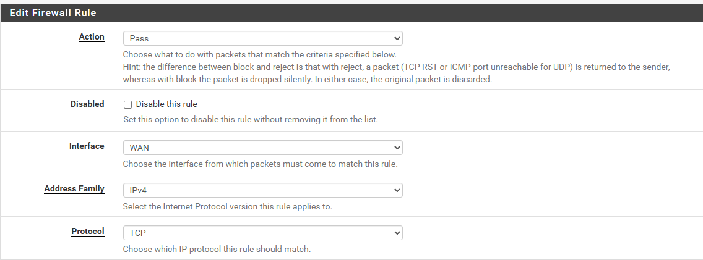
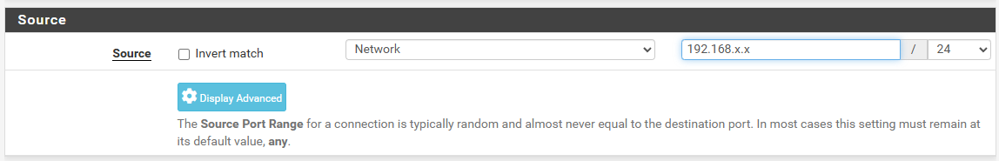
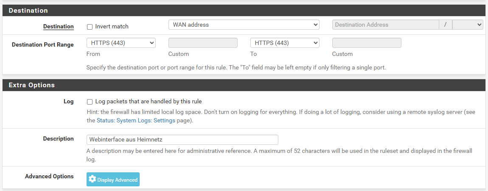

Nach dem Speichern der Regel lädt die pfSense die Regeln neu, die Firewall ist dann automatisch wieder aktiv.

### Interfaces umbenennen

- LAN → Management
- OPT1 → Opfer
- OPT2 → Angreifer

### Was darf wer?

| Von → Nach | Erlaubt? | Warum |
|---|---|---|
| Angreifer → Opfer | alles | Das ist der Sinn des Labs |
| Opfer → Angreifer | alles | Für Reverse Shells |
| Opfer → Wazuh | nur Port 1514 und 1515 | Wazuh-Agents liefern ihre Logs ab |
| Lab → pfSense DNS | nur Port 53 | Damit Namen wie google.com aufgelöst werden |
| Angreifer → Management | nein | Der Angreifer soll mein SIEM nicht angreifen |
| Lab → Heimnetz | nein | Verwundbare VMs dürfen nie an meine echten Geräte |
| Lab → pfSense Webinterface | nein | Opfer und Angreifer sollen die Firewall nicht verwalten können |
| Lab → Internet | erlaubt | Für Updates und Downloads |
| Management → Heimnetz | nein | Defense in Depth |

### Aliase

| Alias        | Inhalt                                    | Zweck                                     |
| ------------ | ----------------------------------------- | ----------------------------------------- |
| PRIVATE_NETS | 10.0.0.0/8, 172.16.0.0/12, 192.168.0.0/16 | Block-Regeln für private Netze            |
| WAZUH        | 10.10.10.10                               | Agent-Regel und Port-Weiterleitungen      |
| LAB_SCHUTZ   | 10.10.10.0/24, 10.10.20.0/24              | HOME_NET für Suricata (siehe Abschnitt 7) |

### Firewall-Regeln erstellen
**Angreifer → Opfer**
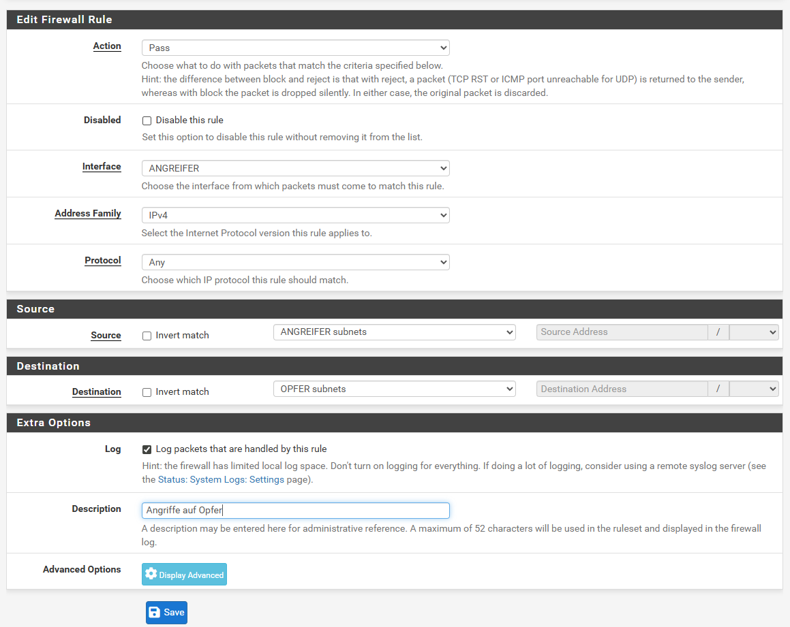

**Opfer → Angreifer**
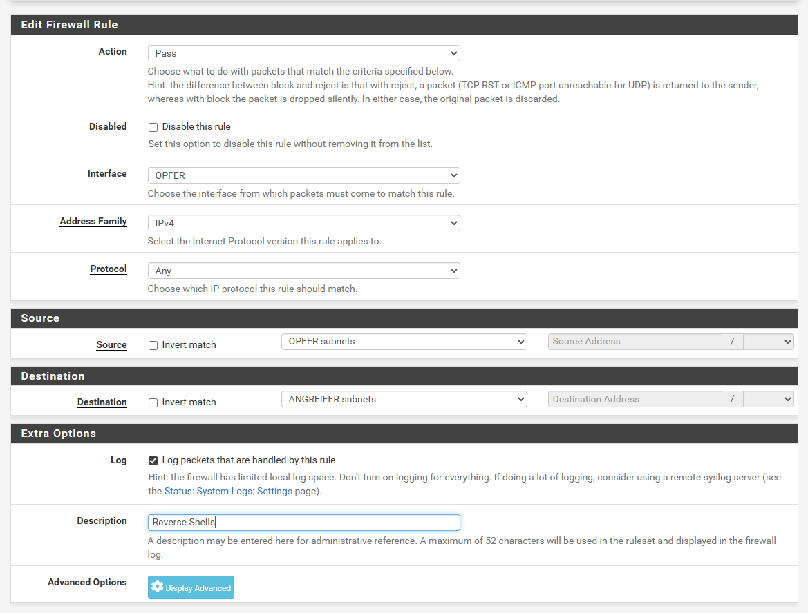

**Angreifer → Management**
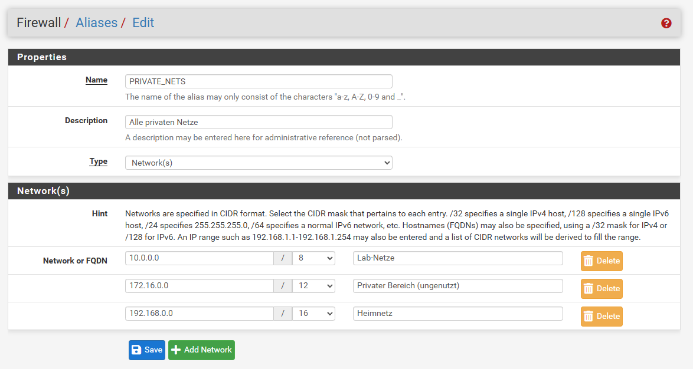
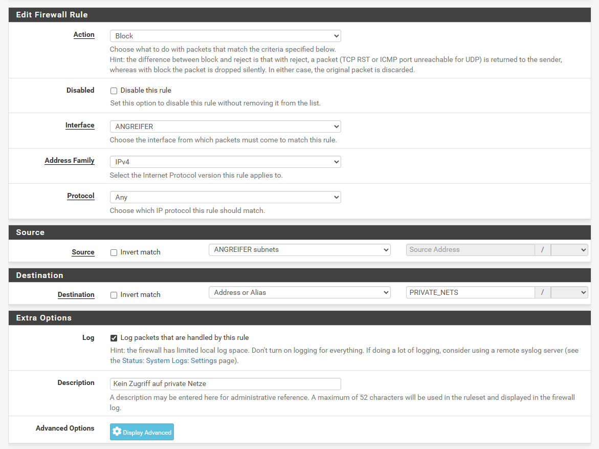

**Opfer → Wazuh**
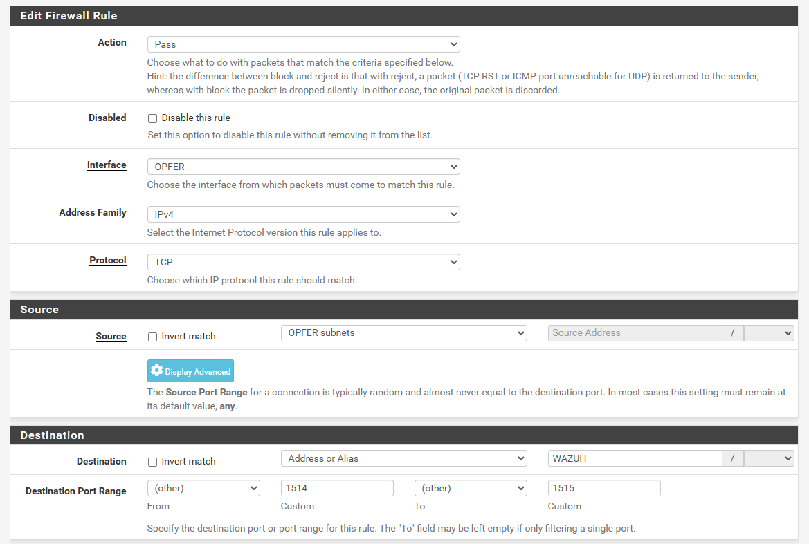
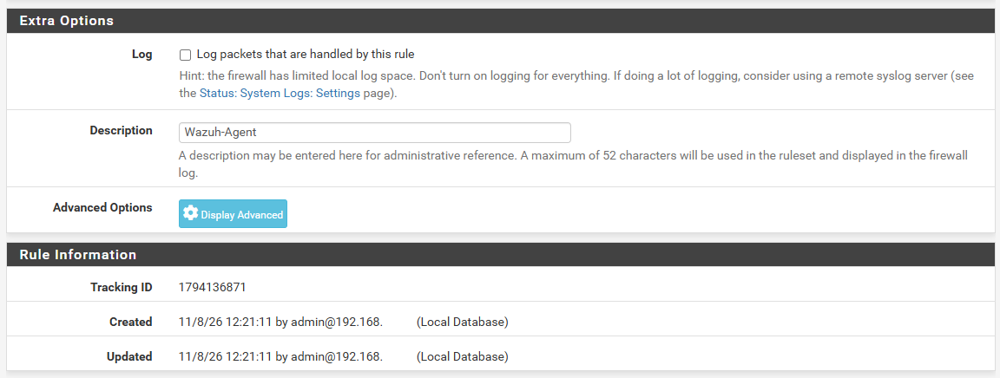

**Opfer → Heimnetz**
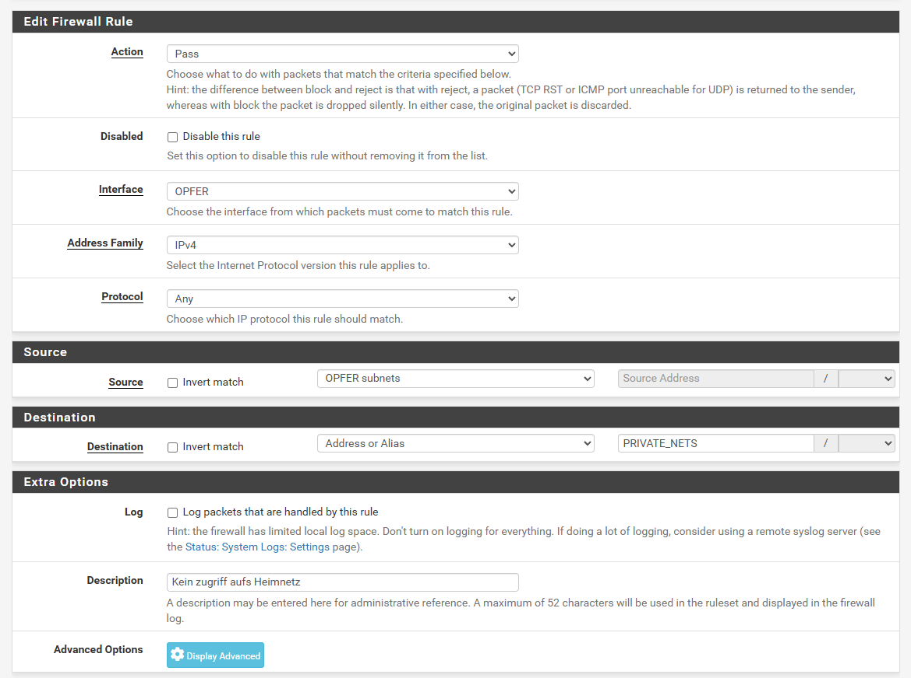

**Management → Heimnetz**
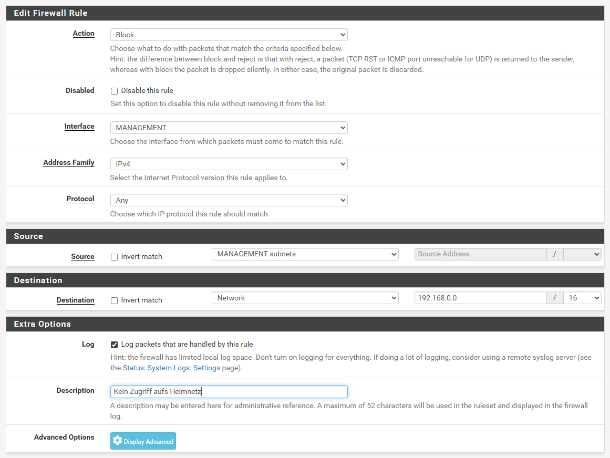

### Alle Regeln pro Netz (in genau dieser Reihenfolge)

pfSense arbeitet die Regeln von oben nach unten ab, die erste passende Regel gewinnt. Deshalb stehen die Block-Regeln für private Netze vor der allgemeinen Internet-Regel.

**ANGREIFER**

| #   | Action | Protocol | Source            | Destination       | Port     | Description                                    |
| --- | ------ | -------- | ----------------- | ----------------- | -------- | ---------------------------------------------- |
| 1   | Pass   | Any      | ANGREIFER subnets | OPFER subnets     |          | Angriffe auf Opfer                             |
| 2   | Pass   | TCP/UDP  | ANGREIFER subnets | ANGREIFER address | DNS (53) | DNS über pfSense                               |
| 3   | Block  | Any      | ANGREIFER subnets | PRIVATE_NETS      |          | Kein Zugriff auf private Netze (Logging aktiv) |
| 4   | Pass   | Any      | ANGREIFER subnets | any               |          | Internet                                       |

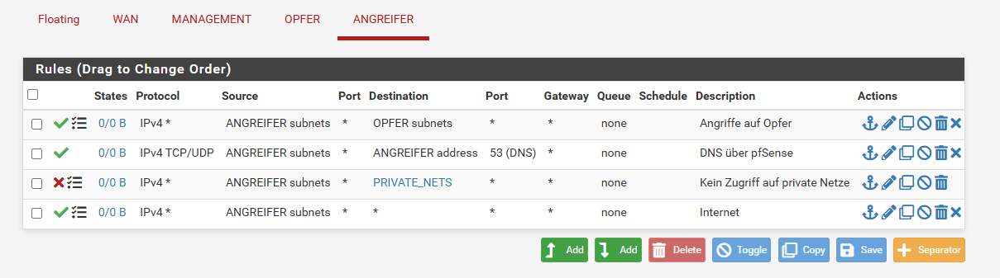

**OPFER**

| # | Action | Protocol | Source | Destination | Port | Description |
|---|---|---|---|---|---|---|
| 1 | Pass | TCP | OPFER subnets | WAZUH | 1514 bis 1515 | Wazuh-Agent |
| 2 | Pass | Any | OPFER subnets | ANGREIFER subnets | | Reverse Shells |
| 3 | Pass | TCP/UDP | OPFER subnets | OPFER address | DNS (53) | DNS über pfSense |
| 4 | Block | Any | OPFER subnets | PRIVATE_NETS | | Kein Zugriff auf private Netze |
| 5 | Pass | Any | OPFER subnets | any | | Internet |

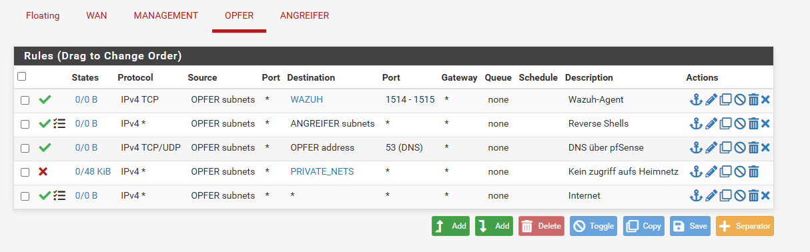

**MANAGEMENT**

| # | Regel |
|---|---|
| 1 | Anti-Lockout Rule |
| 2 | Kein Zugriff aufs Heimnetz |
| 3 | Default allow LAN to any rule |
| 4 | Default allow LAN IPv6 to any rule |


**WAN**

| #   | Regel                                                         |
| --- | ------------------------------------------------------------- |
| 1   | Webinterface aus Heimnetz (192.168.X.0/24 → WAN address, 443) |


---

[Inhaltsverzeichnis](README.md) · Weiter: [02 Wazuh-Installation](02-wazuh-installation.md)

