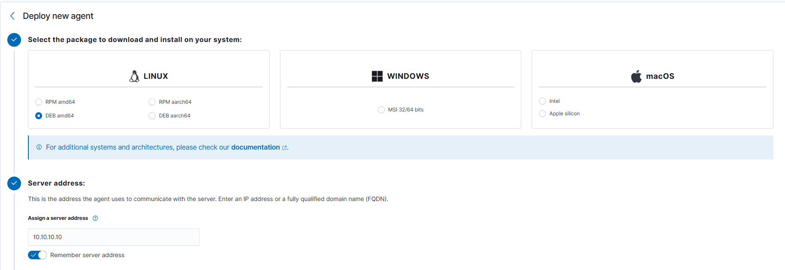
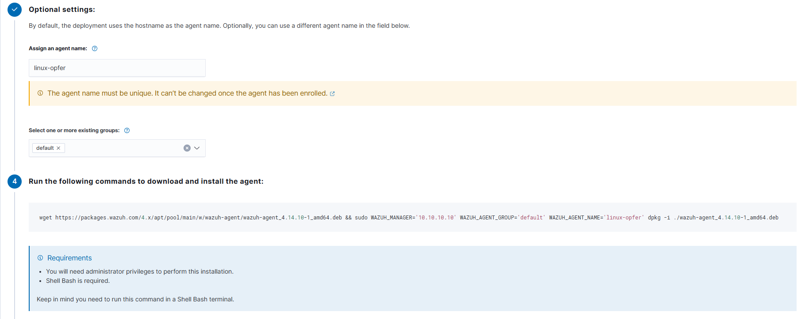
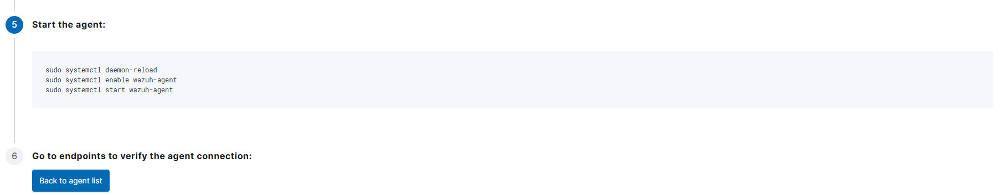
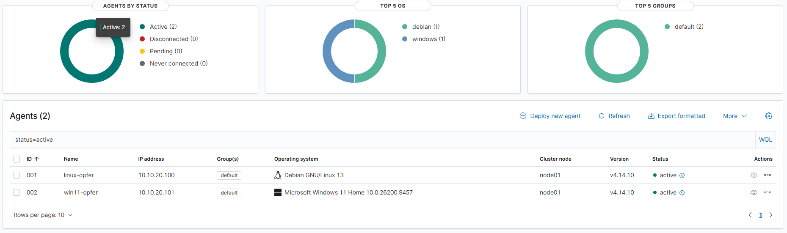

# 02 Wazuh-Installation

Wazuh All-in-One installieren, Dashboard erreichen, Agents verbinden.

### Wazuh-VM über SSH erreichbar machen vom Heimnetz
Gleiches Prinzip wie bei der pfSense Weboberfäche für SSH, damit ich Befehle bequemer ausführen kann und auch einfügen direkt in der Konsole(in der Proxmox-Konsole geht kein Einfügen).

in pfSense unter **Firewall → NAT → Port Forward → ADD** 

| Feld                 | Wert                                 |
| -------------------- | ------------------------------------ |
| Interface            | WAN                                  |
| Source               | 192.168.X.0/24                       |
| Destination          | **WAN address** (nicht die Wazuh-IP) |
| Destination port     | 2222                                 |
| Redirect target IP   | WAZUH                                |
| Redirect target port | SSH (22)                             |

Am ende auf **Save** und danach auf **Apply Changes** damit es auch übernommen wird.

Wichtig: **Destination** ist, wohin das Paket ursprünglich geht (die pfSense selbst). **Redirect target** ist, wohin die pfSense es weiterleitet (die Wazuh-VM).

dann sollte man in der liste die einstellung sehen 


Dann kann man sich mit dem bevorzugten SSH Tool Verbinden das Beispiel zeigt es über PowerShell:
```powershell
ssh debian@192.168.X.54 -p 2222
```
### Wazuh Instalieren 
```bash
curl -sO https://packages.wazuh.com/4.14/wazuh-install.sh && bash ./wazuh-install.sh -a -i
```

-a steht für All-in-One: Manager, Indexer und Dashboard auf einer VM 

-i heißt Betriebssystem-Prüfung ignorieren, weil Debian 13 offiziell noch nicht unterstützt wird

Dann durchlaufen lassen.

### Dashboard aus dem Heimnetz erreichen

Damit ich Wazuh auch über meinen Computer im Heimnetz erreichen kann, muss ich in pfSense eine Port-Weiterleitung hinzufügen wie vorher fürs SSH.
Das heist wir machen die gleichen schritte wie bei **Wazuh-VM über SSH erreichbar machen vom Heimnetz**


**Firewall → NAT → Port Forward**: Port 8443 auf der WAN-Adresse wird an 10.10.10.10:443 weitergeleitet. So erreiche ich das Dashboard unter `https://192.168.X.54:8443`.

### Wazuh-Agents

Über den Wizard von Wazuh bekommen wir ggesagt was wir machen müssen um einen Agent auf unsere Opfer-VMs zu bekommen um diese dann überwachen zu können den Ablauf sieht man einmal an den nachfolgenden Bildern:





Das Gleiche wird dann nochmal für den Windows Agent gemacht.
Dann benutzt man die befehle die man unter punkt 5 bekommt und führt die commands auf der jeweiligen VM aus. 

Danach sieht man beide Agent als aktiv im Dashboard:



---

Zurück: [01 Netzwerk und pfSense](01-netzwerk-und-pfsense.md) · [Inhaltsverzeichnis](README.md) · Weiter: [03 Sysmon auf Windows](03-sysmon-auf-windows.md)
