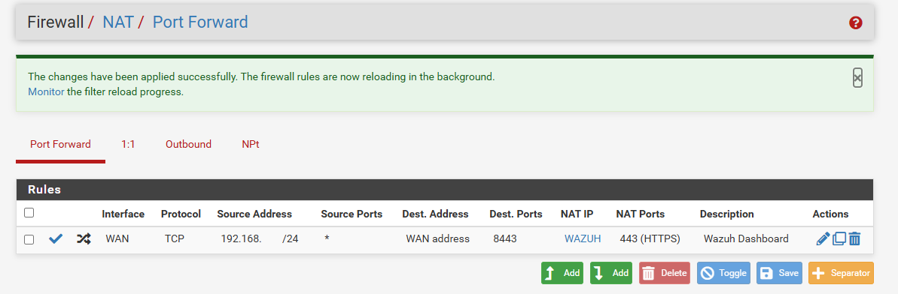

# 02 Wazuh-Installation

Wazuh All-in-One installieren, Dashboard erreichen, Agents verbinden.

### Wazuh-VM über SSH erreichbar machen vom Heimnetz
Gleiches Prinzip wie bei der pfSense Weboberfäche für SSH, damit ich Befehle bequemer ausführen kann und auch einfügen direkt in der Konsole(in der Proxmox-Konsole geht kein Einfügen).

in pfSense unter **Firewall → NAT → Port Forward → ADD** 

| Feld                 | Wert                                 |
| -------------------- | ------------------------------------ |
| Interface            | WAN                                  |
| Source               | 192.168.X.0/24                       |
| Destination          | **WAN address** (nicht die Wazuh-IP) |
| Destination port     | 2222                                 |
| Redirect target IP   | WAZUH                                |
| Redirect target port | SSH (22)                             |

Am ende auf **Save** und danach auf **Apply Changes** damit es auch übernommen wird.

Wichtig: **Destination** ist, wohin das Paket ursprünglich geht (die pfSense selbst). **Redirect target** ist, wohin die pfSense es weiterleitet (die Wazuh-VM).

dann sollte man in der liste die einstellung sehen 

---

Zurück: [01 Netzwerk und pfSense](01-netzwerk-und-pfsense.md) · [Inhaltsverzeichnis](README.md) · Weiter: [03 Sysmon auf Windows](03-sysmon-auf-windows.md)
