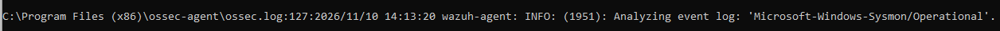
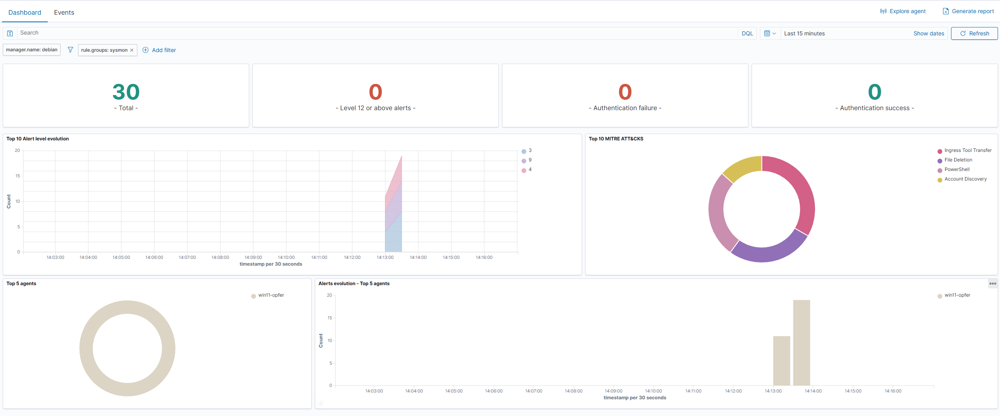

# 03 Sysmon auf Windows

Sysmon mit SwiftOnSecurity-Config installieren und an Wazuh anbinden.

### Warum installiere ich Sysmon? 

Die normalen Windows-Logs geben sehr wenig Informationen aus dem Grund benutze ich Sysmon. Sysmon protokolliert deutlich genauer, welcher Prozess wann was gestartet hat, welche Netzwerkverbindungen aufgebaut und welche Dateien angelegt oder gelöscht wurden. Die Config von SwiftOnSecurity filtert dabei das Rauschen heraus.

### Sysmon installieren

```powershell
mkdir C:\Sysmon
Invoke-WebRequest -Uri https://raw.githubusercontent.com/SwiftOnSecurity/sysmon-config/master/sysmonconfig-export.xml -OutFile C:\Sysmon\sysmonconfig.xml

Dism /Online /Enable-Feature /FeatureName:Sysmon

sysmon -i
sysmon -c C:\Sysmon\sysmonconfig.xml
```

`C:\Program Files (x86)\ossec-agent\ossec.conf` öffnen (am einfachsten aus der Admin-PowerShell mit `notepad "C:\Program Files (x86)\ossec-agent\ossec.conf"`) und innerhalb des `<ossec_config>` … `</ossec_config>` Blocks den nachfolgenden Code einfügen:

 ```xml
<localfile>
  <location>Microsoft-Windows-Sysmon/Operational</location>
  <log_format>eventchannel</log_format>
</localfile>
```
danach müssen wir den Agent neu starten damit die neue config geladen wird 

```powershell
Restart-Service -Name wazuh
Get-Service wazuh
```

wenn nach dem neu laden keine Fehler kommen können wir prüfen ob der Wazuh-Agent das Sysmon-Log lesen kann:

```powershell
Select-String -Path "C:\Program Files (x86)\ossec-agent\ossec.log" -Pattern "Sysmon"
```



Jetzt können wir im Wazuh-Dashboard nachschauen und sehen, dass bereits Sysmon-Events verarbeitet und MITRE-Techniken zugeordnet werden.


---

Zurück: [02 Wazuh-Installation](02-wazuh-installation.md) · [Inhaltsverzeichnis](README.md) · Weiter: [04 Grundlagen: Decoder und Regeln](04-grundlagen-decoder-und-regeln.md)
