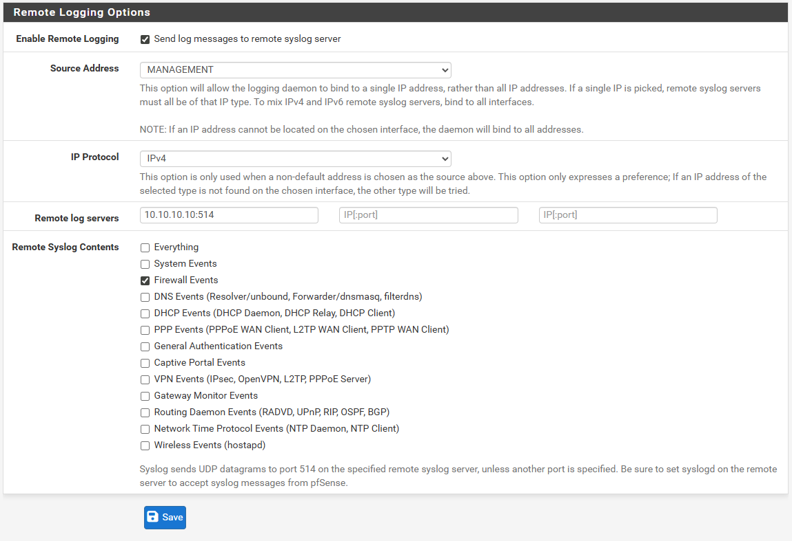

# 05 pfSense-Logs an Wazuh

Firewall-Logs per Syslog an Wazuh, eigener Decoder und Portscan-Erkennung.

### Ziel: 
Wazuh soll nicht nur sehen, was auf den Opfer-Rechnern passiert, sondern auch, was die Firewall blockt. Zum Beispiel, wenn Kali versucht, ins Management-Netz zu scannen.


### Wazuh soll Syslog empfangen

```bash
sudo nano /var/ossec/etc/ossec.conf
```

Im `<ossec_config>` … `</ossec_config>` Block einen zusätzlichen remote-Block hinzufügen (den vorhandenen für die Agents stehen lassen):


```xml
<remote>
  <connection>syslog</connection>
  <port>514</port>
  <protocol>udp</protocol>
  <allowed-ips>10.10.10.1</allowed-ips>
  <local_ip>10.10.10.10</local_ip>
</remote>
```

`allowed-ips` ist die pfSense im Management-Netz. Nur von dort nimmt Wazuh Syslog an.

Dann den Wazuh-Manager neu starten, damit er die geänderte Datei übernimmt:


```bash
sudo systemctl restart wazuh-manager
sudo systemctl status wazuh-manager
```

### pfSense schickt die Logs
**Status → System Logs → Settings**:

- **Log Message Format:** **syslog (RFC 5424)** (warum, siehe Fehlersuche unten)
- Ganz unten **Enable Remote Logging** anhaken
- **Source Address:** MANAGEMENT
- **IP Protocol:** IPv4
- **Remote log servers:** `10.10.10.10:514`
- **Remote Syslog Contents:** Firewall Events (für Suricata später zusätzlich System Events)
- **Save**



### Logging an der Block-Regel einschalten

pfSense loggt eigene Block-Regeln standardmäßig nicht. Unter *Firewall → Rules → ANGREIFER* bei der Regel „Kein Zugriff auf private Netze“ den Haken **„Log packets that are handled by this rule“** setzen, Save, **Apply Changes**.

### Test mit Kali

```bash
nmap -Pn -sS 10.10.10.10
```

Ohne `-Pn` meldet nmap „Host seems down“, weil die Firewall sogar den Ping blockt. Das zeigt schon, dass die Segmentierung funktioniert: Aus Sicht des Angreifers ist das Management-Netz unsichtbar.

In der pfSense unter **Status → System Logs → Firewall** sieht man jeden geblockten Port-Versuch von 10.10.30.100. Damit nur die Kali-Einträge zu sehen sind, über das Trichter-Symbol oben rechts den **Advanced Log Filter** öffnen, bei **Source IP Address** `10.10.30.100` eintragen und **Apply Filter** klicken.


Alle Versuche laufen über das Interface ANGREIFER und werden von der Regel „Kein Zugriff auf private Netze“ geblockt, auf viele verschiedene Ports (22, 445, 3389, 8080 …).


> [!NOTE]
> Inhalt folgt.

---

Zurück: [04 Grundlagen: Decoder und Regeln](04-grundlagen-decoder-und-regeln.md) · [Inhaltsverzeichnis](README.md) · Weiter: [06 Suricata (IDS)](06-suricata.md)
