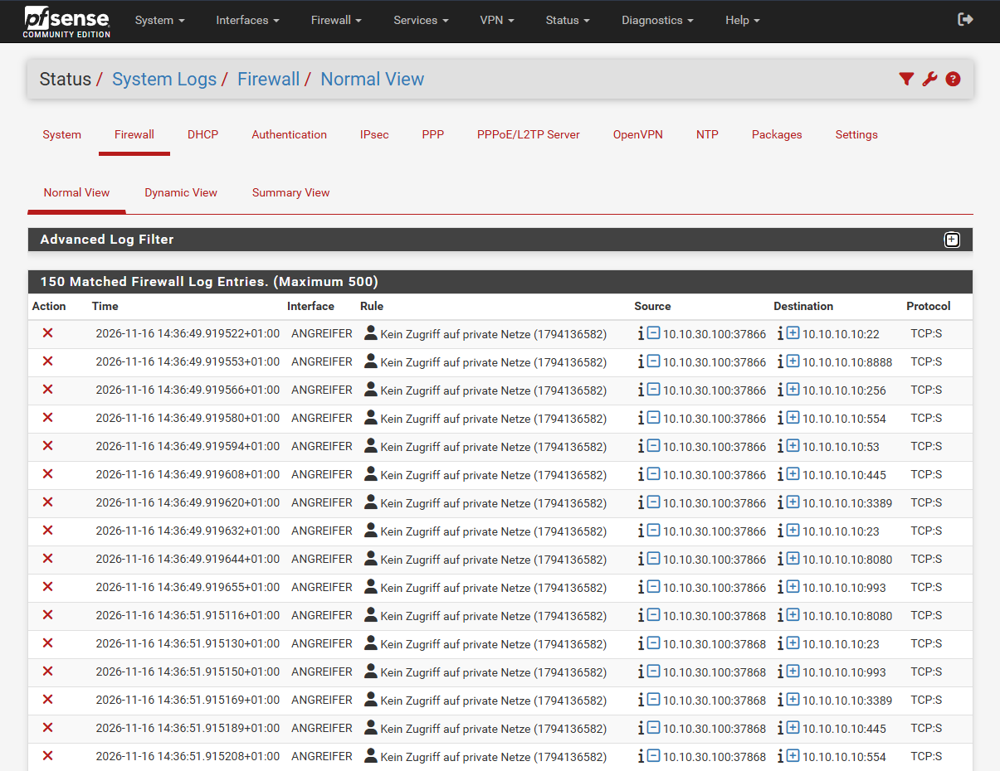
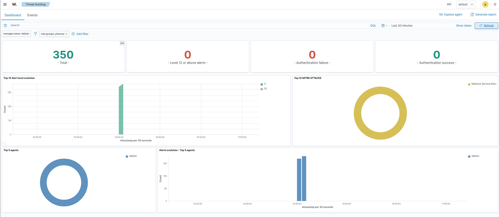
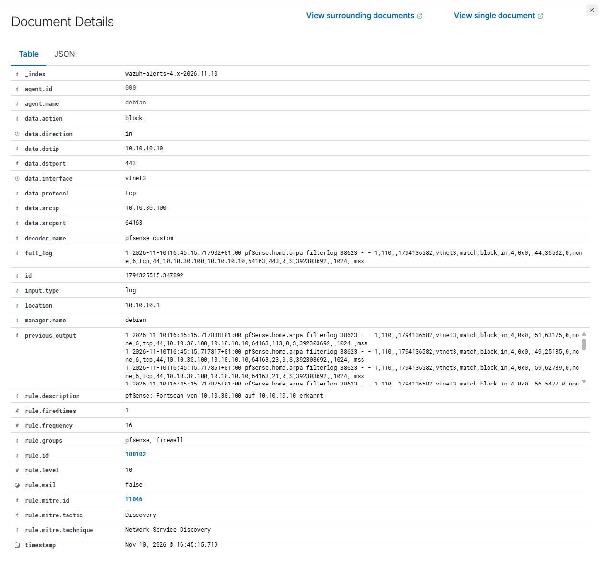

# 05 pfSense-Logs an Wazuh

Firewall-Logs per Syslog an Wazuh, eigener Decoder und Portscan-Erkennung.

### Ziel: 
Wazuh soll nicht nur sehen, was auf den Opfer-Rechnern passiert, sondern auch, was die Firewall blockt. Zum Beispiel, wenn Kali versucht, ins Management-Netz zu scannen.


### Wazuh soll Syslog empfangen

```bash
sudo nano /var/ossec/etc/ossec.conf
```

Im `<ossec_config>` … `</ossec_config>` Block einen zusätzlichen remote-Block hinzufügen (den vorhandenen für die Agents stehen lassen):


```xml
<remote>
  <connection>syslog</connection>
  <port>514</port>
  <protocol>udp</protocol>
  <allowed-ips>10.10.10.1</allowed-ips>
  <local_ip>10.10.10.10</local_ip>
</remote>
```

Vollständig: [manager-remote-syslog.xml](../wazuh/ossec-snippets/manager-remote-syslog.xml)

`allowed-ips` ist die pfSense im Management-Netz. Nur von dort nimmt Wazuh Syslog an.

Dann den Wazuh-Manager neu starten, damit er die geänderte Datei übernimmt:


```bash
sudo systemctl restart wazuh-manager
sudo systemctl status wazuh-manager
```

### pfSense schickt die Logs
**Status → System Logs → Settings**:

- **Log Message Format:** **syslog (RFC 5424)** (warum, siehe Fehlersuche unten)
- Ganz unten **Enable Remote Logging** anhaken
- **Source Address:** MANAGEMENT
- **IP Protocol:** IPv4
- **Remote log servers:** `10.10.10.10:514`
- **Remote Syslog Contents:** Firewall Events (für Suricata später zusätzlich System Events)
- **Save**


### Logging an der Block-Regel einschalten

pfSense loggt eigene Block-Regeln standardmäßig nicht. Unter *Firewall → Rules → ANGREIFER* bei der Regel „Kein Zugriff auf private Netze“ den Haken **„Log packets that are handled by this rule“** setzen, Save, **Apply Changes**.

### Test mit Kali

```bash
nmap -Pn -sS 10.10.10.10
```

Ohne `-Pn` meldet nmap „Host seems down“, weil die Firewall sogar den Ping blockt. Das zeigt schon, dass die Segmentierung funktioniert: Aus Sicht des Angreifers ist das Management-Netz unsichtbar.

In der pfSense unter **Status → System Logs → Firewall** sieht man jeden geblockten Port-Versuch von 10.10.30.100. Damit nur die Kali-Einträge zu sehen sind, über das Trichter-Symbol oben rechts den **Advanced Log Filter** öffnen, bei **Source IP Address** `10.10.30.100` eintragen und **Apply Filter** klicken.



Alle Versuche laufen über das Interface ANGREIFER und werden von der Regel „Kein Zugriff auf private Netze“ geblockt, auf viele verschiedene Ports (22, 445, 3389, 8080 …).

### Fehlersuche: Logs kommen an, aber keine Alerts

Auf der Wazuh-VM:

```bash
apt install tcpdump
tcpdump -i any -n udp port 514
```

Ergebnis: Die Pakete von 10.10.10.1 kommen an. Im Dashboard erscheint trotzdem nichts. Um zu gucken woran das legen kann aktiviere ich wieder `logall` und prüfe mit `wazuh-logtest` eine echte Zeile:

```bash
grep filterlog /var/ossec/logs/archives/archives.log | tail -n 1 | sed 's/^[^>]*>[^ ]* //' | /var/ossec/bin/wazuh-logtest
```

**Ergebnis mit BSD-Format (RFC 3164):**
```
hostname: 'filterlog[38623]:'
No decoder matched.
```
Die pfSense schickt im BSD-Format keinen Hostnamen mit. Wazuh erwartet aber den Aufbau Datum, Hostname, Programm. Deshalb hält Wazuh `filterlog[38623]:` für den Hostnamen, der Programmname fehlt, und der mitgelieferte pfSense-Decoder erkennt die Zeile nicht.

**Ergebnis mit RFC 5424:**
Die Zeile wird gar nicht vorab dekodiert (kein Zeitstempel, kein Hostname erkannt), ebenfalls „No decoder matched“.

**Fazit:** Mit pfSense 2.8.1 funktioniert keines der beiden Formate mit den mitgelieferten Wazuh-Decodern. Lösung: pfSense auf RFC 5424 lassen (die Zeilen sind dort vollständig) und einen **eigenen Decoder** sowie **eigene Regeln** schreiben.

> [!NOTE]
> Bei der Problemlösung hat mir KI wieder geholfen mit eigener Recherche

### Eigener Decoder

> [!NOTE]
> Diesen Decoder habe ich mit KI-Unterstützung erstellt. Getestet habe ich ihn selbst mit `wazuh-logtest` und live im Dashboard.

In `local_decoder.xml` ans Ende einfügen:

```xml
<decoder name="pfsense-custom">
  <prematch type="pcre2">^1 \S+ \S+ filterlog \d+ - - </prematch>
</decoder>

<decoder name="pfsense-custom-ipv4">
  <parent>pfsense-custom</parent>
  <regex type="pcre2" offset="after_parent">^[^,]*,[^,]*,[^,]*,[^,]*,([^,]*),[^,]*,([^,]*),([^,]*),4,(?:[^,]*,){7}([^,]*),[^,]*,([^,]*),([^,]*)(?:,([^,]*),([^,]*))?</regex>
  <order>interface,action,direction,protocol,srcip,dstip,srcport,dstport</order>
</decoder>
```

Vollständig: [local_decoder.xml](../wazuh/local_decoder.xml)

- Der erste Decoder erkennt „das ist eine pfSense-Firewallzeile“.
- Der zweite zerlegt die kommagetrennten Werte (IPv4) und liefert die Felder **interface, action, direction, protocol, srcip, dstip, srcport, dstport**.

Test im logtest, Phase 2:

```
name: 'pfsense-custom'
action: 'block'
direction: 'in'
dstip: '10.10.10.10'
dstport: '9418'
interface: 'vtnet3'
protocol: 'tcp'
srcip: '10.10.30.100'
srcport: '51795'
```

### Eigene Regeln

**Aufbau in Stufen**

| ID | Level | Aufgabe |
|---|---|---|
| 100100 | 0 | sammelt alle pfSense-Events, bewertet noch nichts |
| 100101 | 3 | einzelner Block aus den Lab-Netzen (10.10.0.0/16) |
| 100102 | 10 | Portscan: viele Blocks von derselben IP in kurzer Zeit |

Warum bewertet man nicht alles mit einem hohen level?: Die Firewall blockt ständig etwas, das ist ihre aufgabe. Wenn jedes einzelne Paket ein hoher Alarm wäre, würde man den echten Angriff zwischen tausend Fehlalarmen übersehen (**Alert Fatigue**). Interessant wird es erst, wenn **dieselbe Quelle sehr oft** geblockt wird.

In `local_rules.xml` nach dem letzten `</group>`:

```xml
<group name="pfsense,firewall,">
  <rule id="100100" level="0">
    <decoded_as>pfsense-custom</decoded_as>
    <description>Erfasste pfSense-Firewall-Events</description>
  </rule>

  <rule id="100101" level="3">
    <if_sid>100100</if_sid>
    <action>block</action>
    <srcip>10.10.0.0/16</srcip>
    <description>Erfasste geblockte port verbindungen</description>
  </rule>

  <rule id="100102" level="10" frequency="16" timeframe="10" ignore="120">
    <if_matched_sid>100101</if_matched_sid>
    <same_srcip />
    <description>pfSense: Portscan von $(srcip) auf $(dstip) erkannt</description>
    <mitre>
      <id>T1046</id>
    </mitre>
  </rule>
</group>
```

Vollständig: [local_rules.xml](../wazuh/local_rules.xml)

**Begründung der Werte**

*Regel 100100*
- `decoded_as pfsense-custom`: hängt sich direkt an den Decoder
- Level 0: nur einsortieren, kein Alert. So machen es auch die Wazuh-eigenen Basisregeln.

*Regel 100101*
- `if_sid 100100`: wird nur geprüft, wenn die Basisregel angewendet wurde
- `<action>block</action>`: `action` ist in Wazuh ein **statisches Feld** und hat ein eigenes Tag. `<field name="action">` führt zum Fehler „action is static“.
- `srcip 10.10.0.0/16`: alle drei Lab-Netze (10.10.10.x, 10.10.20.x, 10.10.30.x). Das Rauschen aus dem Heimnetz wird so ignoriert.
- Level 3: sichtbar, aber ganz unten in der Wichtigkeit. Ein einzelner Block ist noch kein Angriff.

*Regel 100102*
- `if_matched_sid 100101`: zählt die Treffer von 100101. Nicht 100100, sonst würde auch erlaubter Verkehr mitgezählt.
- `frequency 16`: Ein einzelner blockierter Verbindungsversuch erzeugt durch TCP-Wiederholungen schon 5 bis 6 Einträge. 16 versuche liegen deutlich über den 5 bis 6, aber weit unter den Hunderten Blocks eines nmap-Scans.
- `timeframe 10`: nmap schafft 16 Blocks in Sekundenbruchteilen, ein verirrtes Programm nicht.
- `ignore 120`: Nach dem Alarm zwei Minuten Ruhe. Sonst gäbe es bei einem Scan Dutzende Portscan-Alerts.
- `same_srcip`: Wazuh zählt pro Quell-IP getrennt. Ohne das würden z. B. 8 Blocks von Kali und 8 von Windows zusammen einen falschen Portscan-Alarm ergeben.
- `$(srcip)` und `$(dstip)` in der Beschreibung: zeigen Angreifer- und Ziel-IP. Den Port lasse ich bewusst weg, weil ein Scan viele Ports betrifft und sonst nur der letzte angezeigt würde.
- MITRE **T1046** (Network Service Discovery), Taktik Discovery. Die Regel ist eine Umsetzung der MITRE-Detection-Strategy **DET0376**.

### Tests mit logtest

Block von Kali (soll 100101 treffen):
```bash
grep 10.10.30.100 /var/ossec/logs/archives/archives.log | grep block | tail -n 1 | sed 's/^[^>]*>[^ ]* //' | /var/ossec/bin/wazuh-logtest
```

Block aus dem Heimnetz (soll bei 100100 bleiben):
```bash
grep 192.168.X /var/ossec/logs/archives/archives.log | grep block | tail -n 1 | sed 's/^[^>]*>[^ ]* //' | /var/ossec/bin/wazuh-logtest
```

Portscan (20 Kali-Blocks auf einmal, beim 16. soll 100102 feuern):
```bash
grep 10.10.30.100 /var/ossec/logs/archives/archives.log | grep block | tail -n 20 | sed 's/^[^>]*>[^ ]* //' | /var/ossec/bin/wazuh-logtest
```

Ergebnis:
```
id: '100102'
level: '10'
description: 'pfSense: Portscan von 10.10.30.100 auf 10.10.10.10 erkannt'
frequency: '16'
mitre.id: '['T1046']'
mitre.tactic: '['Discovery']'
mitre.technique: '['Network Service Discovery']'
```

Pro Event erzeugt Wazuh immer nur einen Alert, und zwar von der passenden Regel. Die Regel 100101 zählt hoch bis zum 16. Block. Der 16. block löst dann den Portscan-Alert aus, danach zählt 100101 normal weiter, aber 100102 bleibt durch `ignore` erstmal 2 Minuten lang still.

### Live-Test im Dashboard

Kali:
```bash
nmap -Pn -sS 10.10.10.10
```

**Dashboard → Threat Hunting**, Zeitraum „Last 15 minutes“, Filter `rule.groups: pfsense`.

Ergebnis: viele Level-3-Alerts (Einzelblocks) und **genau ein** Level-10-Alert pro Scan, mit MITRE „Network Service Discovery“.



Gezielte Suche nach dem Portscan: `rule.id:100102`

In den Details steht `previous_output`: Wazuh speichert bei Korrelationsregeln die Events mit, die zum Alarm geführt haben. Dadurch sieht man direkt, welche Ports Kali abgeklappert hat.



Als „Agent“ steht der Wazuh-Server selbst, weil die pfSense-Logs per Syslog direkt beim Server ankommen und nicht über einen Agent.

> [!NOTE]
> **Bekannte Grenze:** Ein Angreifer kann nmap absichtlich langsam laufen lassen (z. B. `nmap -T1`, ein Port alle paar Sekunden) und so unter der Schwelle von 16 Blocks in 10 Sekunden bleiben. Das ist eine bekannte Grenze von Schwellwert-Erkennung.
---

Zurück: [04 Grundlagen: Decoder und Regeln](04-grundlagen-decoder-und-regeln.md) · [Inhaltsverzeichnis](README.md) · Weiter: [06 Suricata (IDS)](06-suricata.md)
