# 06 Suricata (IDS)

Suricata auf der pfSense, Alarme an Wazuh und Bewertung nach Severity.

### Suricata (IDS)

**Warum Suricata:** Die Firewall sieht nur, wer mit wem auf welchem Port spricht. Suricata ist ein **IDS** (Intrusion Detection System) und schaut **in den Inhalt** der Pakete. Es vergleicht den Verkehr mit Zehntausenden Signaturen bekannter Angriffe. Das ist bei mir besonders wichtig, weil **Angreifer → Opfer** in der Firewall komplett erlaubt ist. Diese Angriffe würde die Firewall nie als Problem melden.

Ich betreibe Suricata im **IDS-Modus** (nur erkennen, nicht blocken). Blocken würde meine Angriffsszenarien verhindern.

### Vorbereitung

- Snapshot der pfSense-VM (114) in Proxmox
- RAM der pfSense: **4 GB** (Suricata braucht mit vielen Regeln 1 bis 2 GB, darunter kann es beim Laden abstürzen)
- mindestens **2 CPU-Kerne**, weil Suricata jedes Paket gegen die Regeln prüft

### Paket installieren

**System → Package Manager → Available Packages** → `suricata` → **Install**

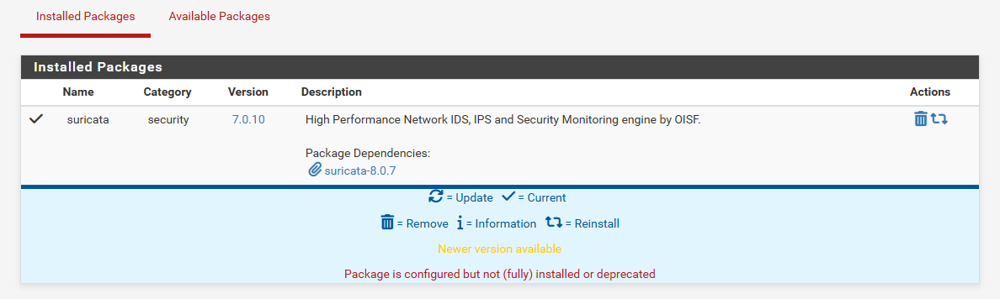

### Regelwerke auswählen (Global Settings)

**Services → Suricata → Global Settings**

| Option | Gewählt | Warum |
|---|---|---|
| ETOpen Emerging Threats | ja | Hauptregelwerk, kostenlos |
| ETPro | nein | kostenpflichtig |
| Snort rules | nein | braucht ein Konto |
| Snort GPLv2 Community | ja | kostenlos, ergänzt ETOpen |
| Feodo Tracker Botnet C2 | ja | bekannte Botnet-Server |
| ABUSE.ch SSL Blacklist | ja | Schadsoftware anhand von SSL-Zertifikaten |
| Hide Deprecated Rules Categories | ja | übersichtlichere Liste |
| Update Interval | 1 DAY | täglich neue Signaturen |
| Keep Suricata Settings After Deinstall | ja | Konfiguration bleibt bei Neuinstallation erhalten |

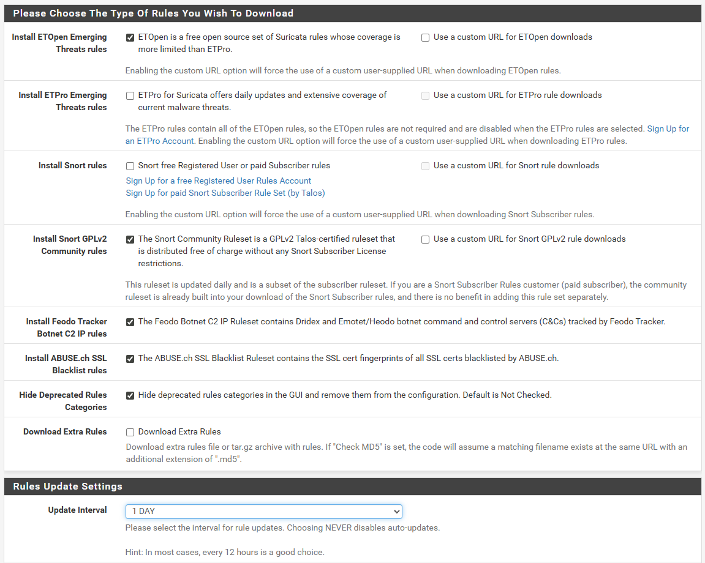
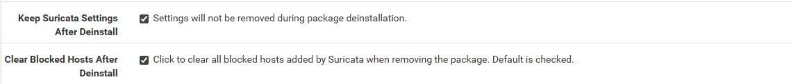

Dann Reiter **Updates** → **Update**. Alle Regelwerke wurden geladen:

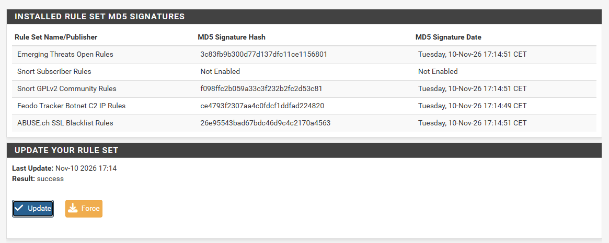

### Hardware-Offloading abschalten

Suricata hat gewarnt, dass Hardware Checksum Offloading, TCP Segmentation Offloading und Large Receive Offloading aktiv sind.

**Grund:** Beim Offloading übernimmt die Netzwerkkarte Aufgaben wie Prüfsummen und das Zerlegen großer Pakete. Suricata greift die Pakete aber vorher ab und sieht dann falsche Prüfsummen oder unnatürlich große Pakete. Das führt zu verpassten Angriffen oder Fehlalarmen, bei virtuellen Netzwerkkarten (virtio) besonders oft.

**System → Advanced → Networking**, drei Haken setzen:
- Disable hardware checksum offload
- Disable hardware TCP segmentation offload
- Disable hardware large receive offload

Save, danach pfSense **neu starten**.

### Interface ANGREIFER einrichten

Warum ANGREIFER: Jeder Angriff von Kali, egal ob auf die Opfer oder aufs Management-Netz, läuft durch dieses Interface.

**Services → Suricata → Interfaces → Add**
- Enable, Interface **ANGREIFER**, Description `ANGREIFER`
- **Send Alerts to System Log**: an
- **Enable EVE JSON Log**: an
- **Block Offenders**: aus (IDS-Modus)

Dann Stift → **ANGREIFER Categories** → **Select All** → Save, und Suricata starten.

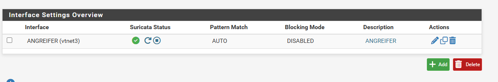

Status grün, **Blocking Mode: DISABLED**.

### HOME_NET festlegen

Die meisten Suricata-Regeln haben eine **Richtung**, z. B. „Alarm, wenn jemand von außen (EXTERNAL_NET) etwas im eigenen Netz (HOME_NET) scannt“. Die pfSense setzt standardmäßig **alle** eigenen Netze als HOME_NET, also auch das Angreifer-Netz. Für Suricata ist Kali damit „intern“, und viele Angriffsregeln hätten nicht gegriffen. Der erste Test blieb deshalb leer.

Für das Lab gilt deshalb:
- **HOME_NET** = Management (10.10.10.0/24) und Opfer (10.10.20.0/24), also das, was ich schützen will
- **EXTERNAL_NET** = alles andere, also auch Kali

Umsetzung:
1. **Firewall → Aliases → IP → Add**: `LAB_SCHUTZ` mit 10.10.10.0/24 und 10.10.20.0/24
2. **Services → Suricata → Pass Lists → Add**: Name `Home_LAB`, alle automatischen Haken entfernen (Local Networks, WAN Gateways, WAN DNS Servers, Virtual IP, VPN Addresses), bei Assigned Aliases `LAB_SCHUTZ`
3. **Interfaces** → Stift bei ANGREIFER → **Home Net:** `Home_LAB`, External Net auf default (= alles, was nicht HOME_NET ist), Save, Suricata neu starten

Danach steht die Pass List bei **Assigned** auf **Yes**:

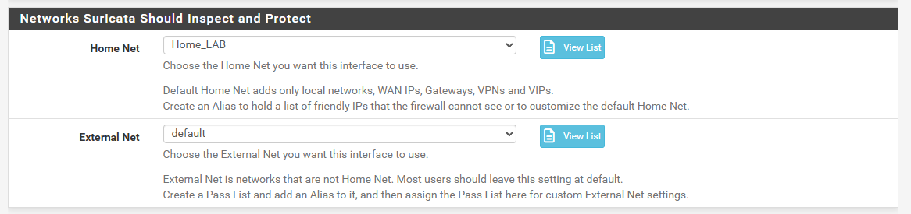
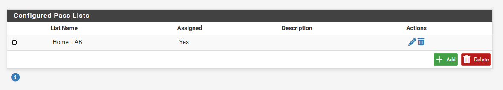

### Test mit Kali

```bash
sudo nmap -sS -sV -O 10.10.20.100
```

`-sV` fragt die Versionen der Dienste ab, `-O` versucht das Betriebssystem zu erkennen. Die Firewall lässt das durch (Angreifer → Opfer ist erlaubt), Suricata erkennt es:

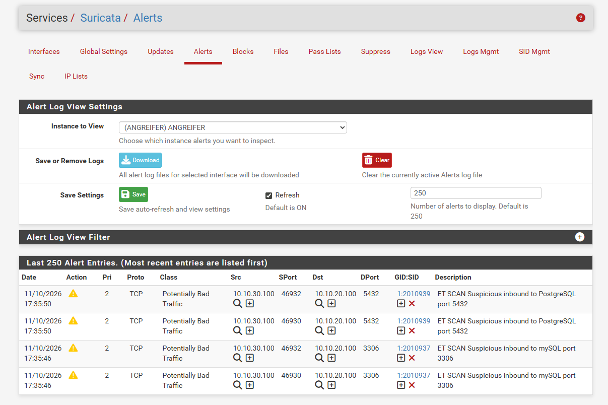

- **ET SCAN Suspicious inbound to mySQL port 3306**
- **ET SCAN Suspicious inbound to PostgreSQL port 5432**

Das Wort **„inbound“** zeigt, warum HOME_NET so wichtig war: Diese Regeln greifen nur bei Verkehr von EXTERNAL_NET nach HOME_NET.

**Hinweis zum Start:** Suricata braucht beim Start knapp eine Minute, um alle Regeln zu laden. Erst wenn in **Logs View → suricata.log** die Zeile `Engine started` steht, wird Verkehr geprüft. Dort steht auch, wie viele Regeln geladen wurden (bei mir 64.716 erfolgreich, 113 fehlgeschlagen).

### Suricata-Alerts an Wazuh

Gleicher Weg wie bei der Firewall: Suricata schreibt ins Systemlog der pfSense, die pfSense schickt es per Syslog an Wazuh.

**Interfaces → Stift bei ANGREIFER → EVE Output Settings**
- **EVE Output Type:** SYSLOG (Facility LOCAL1, Priority NOTICE)
- **EVE Log Alerts:** an
- **Payload Data Formats:** NO und **Log a packet dump with alerts:** aus
- **EVE Logged Traffic** und **EVE Logged Info:** alles aus
- **Send Alerts to System Log** muss an bleiben, sonst lädt die pfSense die Syslog-Ausgabe von Suricata nicht

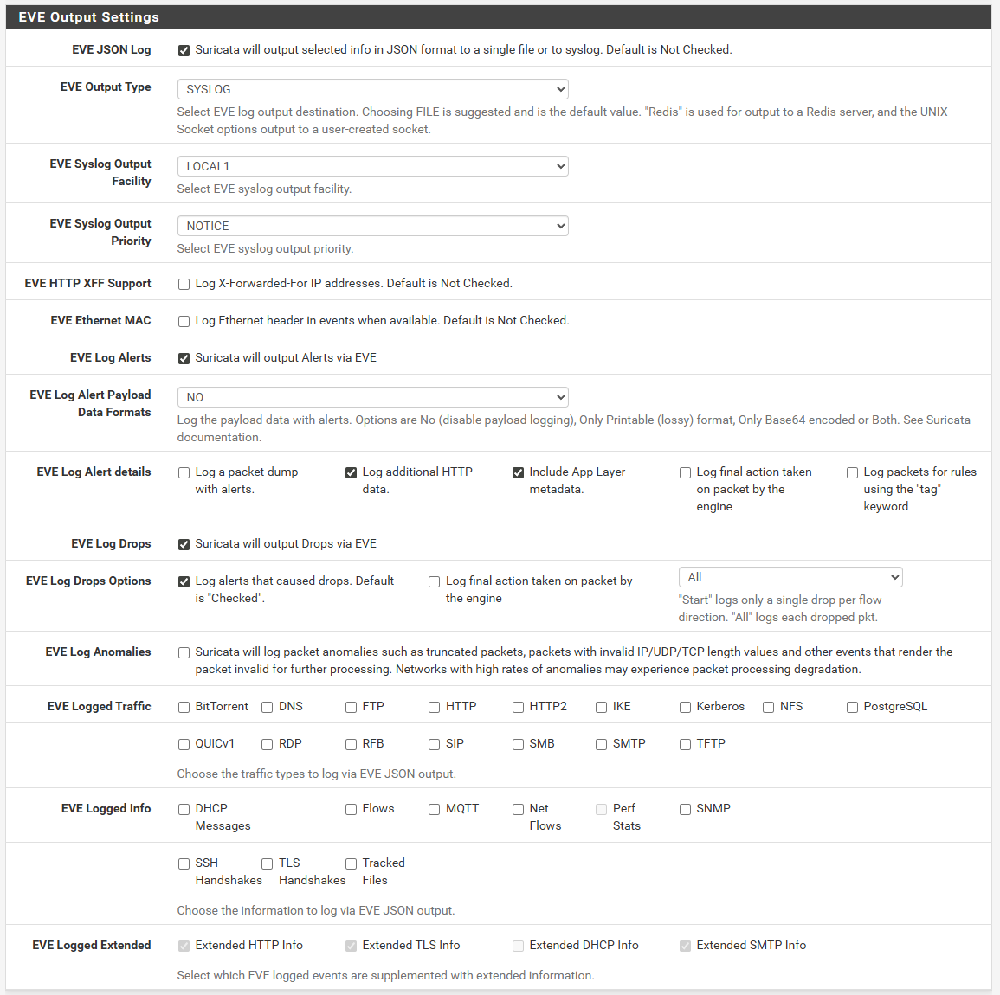

Warum so wenig: Syslog verschickt jede Meldung als einzelnes UDP-Paket mit begrenzter Größe. Mit Payload und Paket-Dump werden die Meldungen zu groß, werden abgeschnitten und das JSON ist kaputt. Die Listen unter „Logged Traffic/Info“ würden jeden normalen Vorgang (jede DNS-Anfrage, jeden TLS-Handshake) melden. Mich interessieren nur die **Alerts**.

Zusätzlich in **Status → System Logs → Settings** bei **Remote Syslog Contents** den Haken **System Events** setzen, dort landen die Suricata-Meldungen.

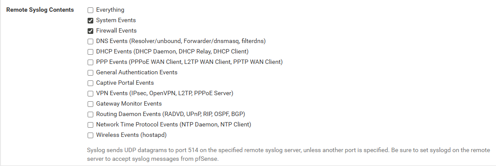

### Was bei Wazuh ankommt

Mit `logall`:
```bash
grep suricata /var/ossec/logs/archives/archives.log | tail -n 4
```

Von jedem Alert kommen **zwei** Zeilen an:
- eine **Kurzform** von „Send Alerts to System Log“:
  `[1:2010937:3] ET SCAN Suspicious inbound to mySQL port 3306 [Classification: ...] {TCP} 10.10.30.100:40797 -> 10.10.20.100:3306`
- die **JSON-Form** von EVE:
  `{"timestamp":...,"event_type":"alert","src_ip":"10.10.30.100",...,"alert":{"signature":"ET SCAN ...","severity":2,...}}`

Aufbau einer Zeile:
```
1 2026-11-10T17:42:15.674501+01:00 pfSense.home.arpa suricata 35380 - - {"timestamp":...}
|------------------ Syslog-Vorspann (RFC 5424) ------------------| |--- JSON ---|
```

Mit der JSON-Form arbeite ich weiter, weil dort jeder Wert einen Namen hat.

### Eigener Decoder


> [!NOTE]
> Diesen Decoder habe ich mit KI-Unterstützung erstellt. Getestet habe ich ihn selbst mit `wazuh-logtest` und live im Dashboard.

Wazuh hat einen eingebauten **JSON_Decoder**, der automatisch aus jedem Schlüssel im JSON ein Feld macht. Ich muss ihm nur sagen, wo das JSON anfängt, nämlich nach dem Syslog-Vorspann.

In `local_decoder.xml` unter die pfSense-Decoder:

```xml
<decoder name="suricata-custom">
  <prematch type="pcre2">^1 \S+ \S+ suricata \d+ - - </prematch>
</decoder>

<decoder name="suricata-custom-json">
  <parent>suricata-custom</parent>
  <prematch offset="after_parent">^{</prematch>
  <plugin_decoder offset="after_parent">JSON_Decoder</plugin_decoder>
</decoder>
```

- **suricata-custom** erkennt am Vorspann eine Suricata-Meldung der pfSense
- **suricata-custom-json** greift nur, wenn danach eine `{` kommt, also nur bei der JSON-Form
- **JSON_Decoder** zerlegt alles ab dem Ende des Vorspanns

Test:
```bash
grep suricata /var/ossec/logs/archives/archives.log | grep event_type | tail -n 1 | sed 's/^[^>]*>[^ ]* //' | /var/ossec/bin/wazuh-logtest
```

Phase 2 (Auszug):
```
name: 'suricata-custom'
event_type: 'alert'
alert.signature: 'ET SCAN Potential VNC Scan 5800-5820'
alert.severity: '2'
alert.category: 'Attempted Information Leak'
alert.signature_id: '2002910'
src_ip: '10.10.30.100'
dest_ip: '10.10.20.100'
dest_port: '5811'
in_iface: 'vtnet3'
```

Verschachtelte Werte bekommen einen Punkt im Namen (`alert.signature`), so spreche ich sie auch in den Regeln an.

### Eigene Regeln

**Aufbau in Stufen**

| ID | Level | Aufgabe |
|---|---|---|
| 100200 | 0 | sammelt alle Suricata-Zeilen ein (Kurzform und JSON), bewertet noch nichts |
| 100201 | 3 | nur echte Alarme (`event_type` = `alert`), deckt auch Severity 3 = niedrig ab |
| 100202 | 7 | Suricata-Severity 2 = mittel |
| 100203 | 10 | Suricata-Severity 1 = hoch |

```
100200  (alle Suricata-Zeilen)
   └── 100201  (nur echte Alarme)
          ├── 100202  (Severity 2 → mittel)
          └── 100203  (Severity 1 → hoch)
```

Die Suricata-Regeln stehen in `local_rules.xml` in einem eigenen Block unter dem pfSense-Block:

```xml
<group name="suricata,ids,">

  <rule id="100200" level="0">
    <decoded_as>suricata-custom</decoded_as>
    <description>Suricata: alle Events</description>
  </rule>

  <rule id="100201" level="3">
    <if_sid>100200</if_sid>
    <field name="event_type">^alert$</field>
    <description>Suricata: $(alert.signature)</description>
  </rule>

  <rule id="100202" level="7">
    <if_sid>100201</if_sid>
    <field name="alert.severity">^2$</field>
    <description>Suricata (mittel): $(alert.signature)</description>
  </rule>

  <rule id="100203" level="10">
    <if_sid>100201</if_sid>
    <field name="alert.severity">^1$</field>
    <description>Suricata (hoch): $(alert.signature)</description>
  </rule>

</group>
```

**Begründung der Werte**

*Regel 100200*
- `decoded_as suricata-custom`: hängt sich an meinen Decoder. Sie erwischt beide Zeilen, die die pfSense pro Alarm schickt.
- Level 0: nur einsortieren, kein Alert.
- Eigene Gruppe `suricata,ids`: Im Dashboard kann ich so nach `rule.groups: suricata` filtern.

*Regel 100201*
- `if_sid 100200`: einfache Kette, jedes einzelne Event wird weitergeprüft. Nicht `if_matched_sid`, das zählt Treffer über einen Zeitraum und gehört zu Korrelationsregeln wie 100102.
- `<field name="event_type">^alert$</field>`: Nur die JSON-Zeile hat das Feld `event_type`. Die Kurzform-Zeile fällt damit raus, und kein Alarm zählt doppelt. `^` und `$` stehen für Anfang und Ende, es muss also *genau* `alert` drinstehen.
- `$(alert.signature)` in der Beschreibung: Im Dashboard sehe ich sofort, welcher Alarm es war. IP und Port stehen ohnehin im Alarm selbst.

*Regeln 100202 und 100203*
- Beide hängen **nebeneinander** an 100201, nicht hintereinander. Würde 100203 an 100202 hängen, würde sie nur Events mit Severity 2 prüfen und könnte nie auf eine 1 passen.
- Bei Suricata ist die Severity **umgekehrt**: 1 = hoch, 3 = niedrig.
- Severity 3 bekommt keine eigene Regel und bleibt bei Level 3 aus 100201.

**Live-Test im Dashboard**

Von Kali:
```bash
nmap -sS -p 3306,5432 10.10.20.100
```

Filter im Dashboard (Threat Hunting → Events):
```
rule.id:(100201 or 100202 or 100203)
```

Ergebnis:
- Erster Test (nur 100201 aktiv): „Suricata: ET SCAN Suspicious inbound to mySQL port 3306“ bzw. „… PostgreSQL port 5432“ mit Level 3, jeder Alarm nur noch einmal.
- Nach 100202: dieselben Alarme mit **Level 7** und Regel 100202. Suricata bewertet diese Scans also mit Severity 2.
- Pro Alarm gibt es genau einen Eintrag. Wazuh geht die Kette durch und meldet nur die tiefste Regel, die gepasst hat.
- 4 Treffer pro Scan: nmap schickt bei Ports ohne Antwort ein zweites Paket hinterher, Suricata meldet jedes davon (Zeitstempel etwa 1 Sekunde auseinander). Die frühere Verdopplung durch die Kurzform-Zeilen hätte genau dieselbe Zeit.

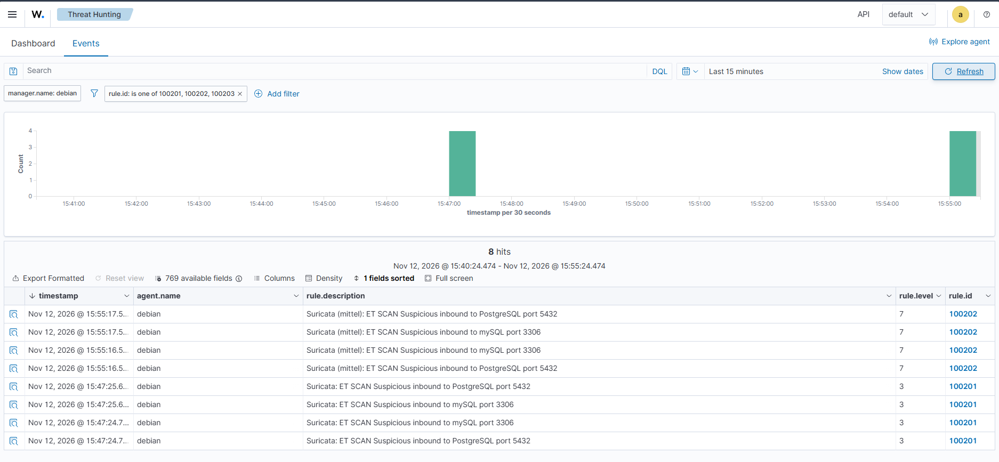

100203 (hoch) hat beim Portscan noch nicht ausgelöst, weil ein Scan nicht als ernst gilt. Getestet wird sie bei den Angriffsszenarien.

---

Zurück: [05 pfSense-Logs an Wazuh](05-pfsense-logs-an-wazuh.md) · [Inhaltsverzeichnis](README.md) · Weiter: [07 FIM, VirusTotal und Active Response](07-fim-virustotal-active-response.md)
