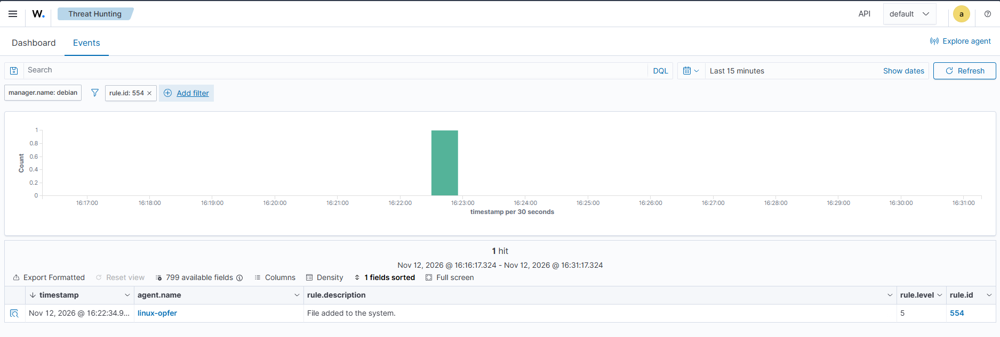
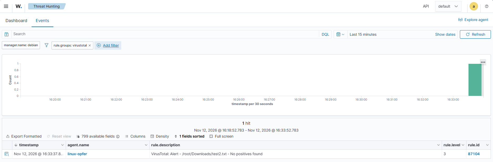
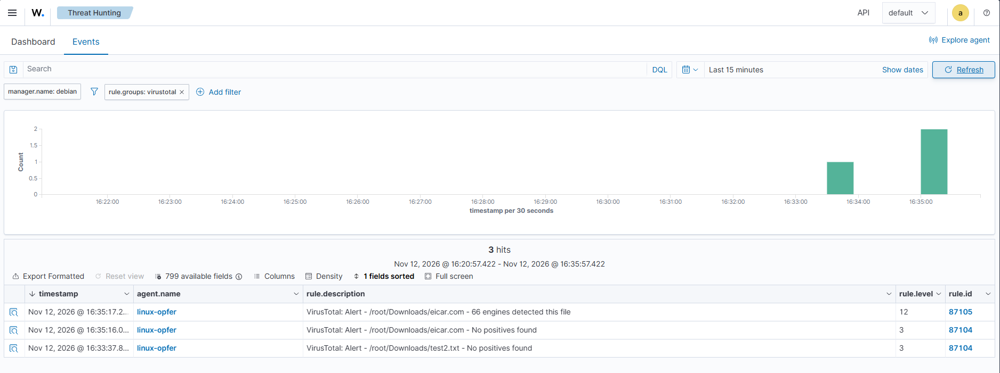
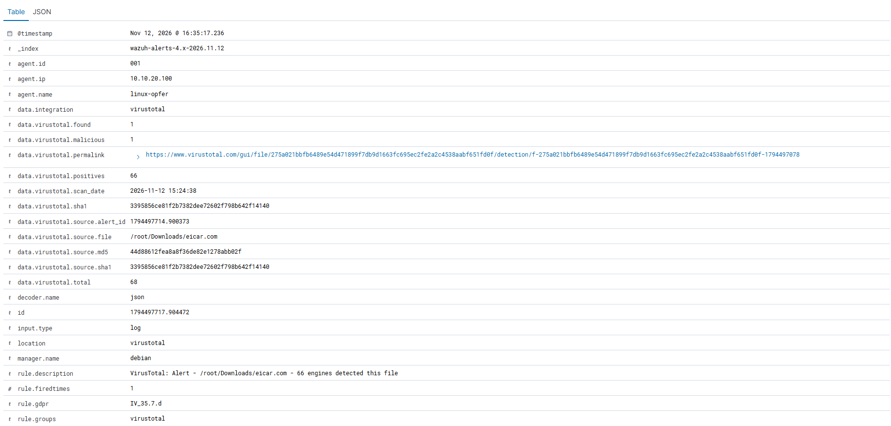
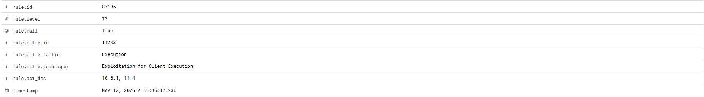
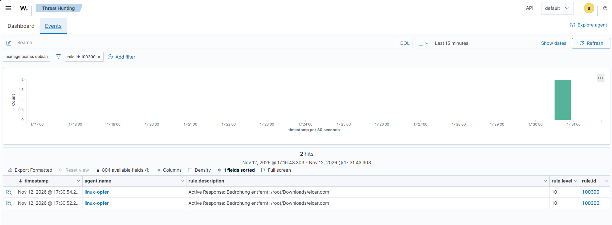
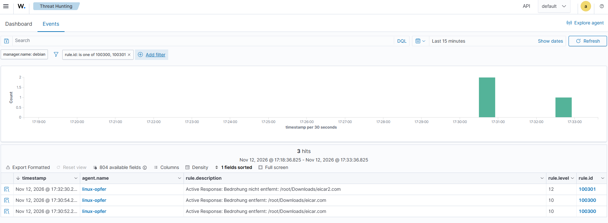
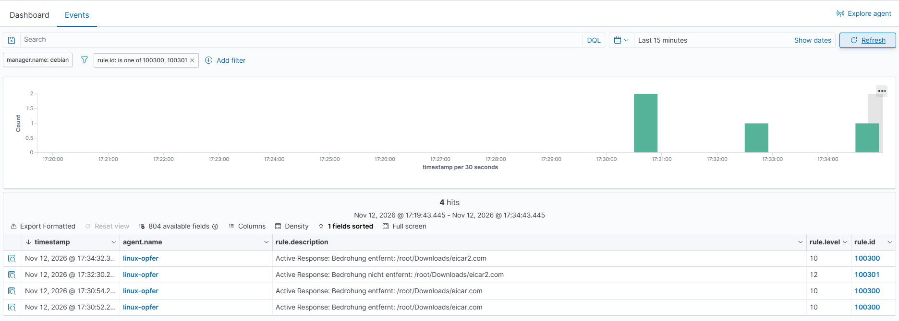
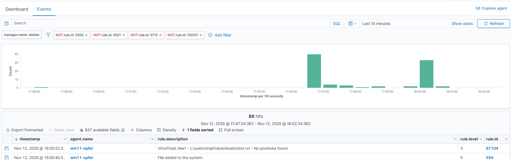
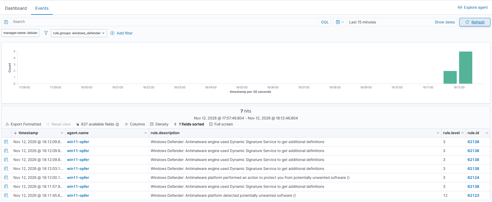

# 07 FIM, VirusTotal und Active Response

Neue Dateien prüfen lassen und Schadsoftware automatisch entfernen.

### Ziel:
Wenn auf einem Opfer eine schädliche Datei auftaucht, soll Wazuh das erkennen, die Datei bei VirusTotal prüfen lassen und sie automatisch löschen. Auf Windows übernimmt das Löschen der Microsoft Defender, Wazuh soll aber sehen, was der Defender getan hat.

### Wie das zusammenhängt

1. Der Agent auf einem Opfer überwacht bestimmte Ordner (**File Integrity Monitoring**, FIM, intern `syscheck`).
2. Taucht dort eine neue Datei auf oder ändert sich eine, meldet der Agent das an den Wazuh-Server.
3. Der Server schickt den **Hash** der Datei an VirusTotal. Die Datei selbst wird nicht hochgeladen.
4. VirusTotal antwortet, wie viele Virenscanner die Datei kennen, und Wazuh macht daraus einen Alarm.
5. Ist die Datei schädlich, schickt der Server per **Active Response** den Auftrag an den Agent, die Datei zu löschen.

```
linux-opfer                    Wazuh-Server                      VirusTotal
───────────                    ────────────                      ──────────
1. FIM sieht eicar.com   ───►  2. fragt nach dem Hash      ───►
                                                             ◄───  "66 von 68: schädlich"
                               3. Regel 87105 greift
                               4. <active-response>:
                                  rules_id 87105 → agent 001 → remove-threat
6. remove-threat.sh       ◄─── 5. Auftrag an den Agent
   löscht die Datei
7. Log-Zeile → Regel 657 → meine Regel 100300 / 100301
```

VirusTotal baut auf FIM auf, deshalb habe ich beides zusammen eingerichtet.

### FIM auf linux-opfer

Überwacht wird ein Downloads-Ordner, weil Schadsoftware dort meistens zuerst landet.

```bash
sudo mkdir -p /root/Downloads
sudo nano /var/ossec/etc/ossec.conf
```

Im Block `<syscheck>` unter die vorhandenen `<directories>`-Zeilen:

```xml
<directories realtime="yes">/root/Downloads</directories>
```

- `realtime="yes"`: neue Dateien werden sofort gemeldet. Ohne das prüft der Agent nur alle 12 Stunden.

Vollständig: [agent-linux.xml](../wazuh/ossec-snippets/agent-linux.xml)

```bash
sudo systemctl restart wazuh-agent
sudo touch /root/Downloads/test.txt
```

Test im Dashboard mit `rule.id:554` („File added to the system“, Level 5).

Erster Test: `test.txt` wird sofort als neue Datei gemeldet.



### VirusTotal-Integration

Kostenloses Konto auf virustotal.com, API-Key unter Profil → API key. Limit: 500 Abfragen pro Tag, 4 pro Minute.

> [!WARNING]
> Der API-Key ist ein Geheimnis. Er gehört nicht ins Repo und nicht auf Screenshots. In der Doku steht deshalb nur ein Platzhalter.

Auf dem **Wazuh-Server** in `/var/ossec/etc/ossec.conf` über das letzte `</ossec_config>`:

```xml
<integration>
  <name>virustotal</name>
  <api_key>DEIN_API_KEY</api_key>
  <group>syscheck</group>
  <alert_format>json</alert_format>
</integration>
```

- `group syscheck`: nur bei FIM-Alarmen wird VirusTotal gefragt
- `alert_format json`: Daten gehen als JSON an das Integrationsskript

Vollständig: [manager-virustotal.xml](../wazuh/ossec-snippets/manager-virustotal.xml)

**Zweiter Test: leere Datei**

`test2.txt` → Regel **87104** „No positives found“ (Level 3). VirusTotal kennt den Hash, aber kein Scanner hält ihn für schädlich. Damit war klar, dass die Verbindung steht.



**Dritter Test: EICAR**

EICAR ist ein harmloser Standard-Test, den alle Virenscanner absichtlich als „Virus“ erkennen.

```bash
sudo wget -O /root/Downloads/eicar.com https://secure.eicar.org/eicar.com
```

→ Regel **87105** „66 engines detected this file“, **Level 12**, MITRE T1203



**Was ein Analyst im Alarm zuerst anschaut**
- `agent.name` / `agent.ip`: wo ist es passiert
- `data.virustotal.source.file`: welche Datei
- `positives` / `total`: wie sicher (66 von 68 ist eindeutig, 1 oder 2 wäre eher ein Fehlalarm)
- `sha1` / `md5`: Fingerabdruck, um dieselbe Datei auf anderen Rechnern zu suchen
- `permalink`: Link zum VirusTotal-Bericht
- `rule.mitre`: automatische Zuordnung zu MITRE ATT&CK




### Active Response: Datei automatisch löschen

**Aufgabenteilung**
- Der **Server** entscheidet, *wann*, *wo* und *womit* reagiert wird (`ossec.conf` auf dem Server).
- Der **Agent** führt das Skript aus, denn nur er kann seine eigene Datei löschen. Das Skript muss deshalb auf **linux-opfer** liegen, nicht auf dem Wazuh-Server.

**Auf linux-opfer:** `jq` installieren (liest JSON) und das Skript anlegen.

> [!NOTE]
> Das Skript `remove-threat.sh` habe ich mit KI-Unterstützung erstellt. Getestet habe ich es selbst, inklusive Fehlerfall.

```bash
sudo apt install -y jq
sudo nano /var/ossec/active-response/bin/remove-threat.sh
```

```bash
#!/bin/bash
# Active Response: löscht eine Datei, die VirusTotal als schädlich gemeldet hat

LOG_FILE="/var/ossec/logs/active-responses.log"

read -r INPUT_JSON
COMMAND=$(echo "$INPUT_JSON" | jq -r '.command')
FILE=$(echo "$INPUT_JSON" | jq -r '.parameters.alert.data.virustotal.source.file')

if [ "$COMMAND" = "add" ]; then
  printf '{"version":1,"origin":{"name":"remove-threat","module":"active-response"},"command":"check_keys","parameters":{"keys":[]}}\n'
  read -r RESPONSE
  if [ "$(echo "$RESPONSE" | jq -r '.command')" != "continue" ]; then
    echo "$(date '+%Y/%m/%d %H:%M:%S') $0: $INPUT_JSON Remove threat aborted" >> "$LOG_FILE"
    exit 0
  fi
fi

if [ -z "$FILE" ] || [ "$FILE" = "null" ]; then
  exit 0
fi

if rm -f -- "$FILE"; then
  echo "$(date '+%Y/%m/%d %H:%M:%S') $0: $INPUT_JSON Successfully removed threat" >> "$LOG_FILE"
else
  echo "$(date '+%Y/%m/%d %H:%M:%S') $0: $INPUT_JSON Error removing threat" >> "$LOG_FILE"
fi

exit 0
```

Als Datei: [remove-threat.sh](../scripts/remove-threat.sh)

```bash
sudo chmod 750 /var/ossec/active-response/bin/remove-threat.sh
sudo chown root:wazuh /var/ossec/active-response/bin/remove-threat.sh
sudo systemctl restart wazuh-agent
```

- `jq -r '.parameters.alert.data.virustotal.source.file'` holt den Dateipfad aus dem Alarm. Gleiche Punkt-Schreibweise wie das Feld im Dashboard.
- Der Agent prüft **beim Start**, welche Skripte vorhanden sind. Deshalb nach dem Anlegen neu starten.

**Auf dem Wazuh-Server** in `ossec.conf`:

```xml
<command>
  <name>remove-threat</name>
  <executable>remove-threat.sh</executable>
  <timeout_allowed>no</timeout_allowed>
</command>

<active-response>
  <disabled>no</disabled>
  <command>remove-threat</command>
  <location>defined-agent</location>
  <agent_id>001</agent_id>
  <rules_id>87105</rules_id>
</active-response>
```

- `command`: verweist auf den Namen aus dem `<command>`-Block
- `location defined-agent` + `agent_id 001`: läuft nur auf linux-opfer
- `rules_id 87105`: nur beim VirusTotal-Fund. Nicht `level`, sonst würde jeder Alarm ab einem Level eine Reaktion auslösen.
- Kein `timeout`, weil man ein Löschen nicht aufheben kann

Vollständig: [manager-active-response.xml](../wazuh/ossec-snippets/manager-active-response.xml)

Für bequemes Arbeiten auf linux-opfer: OpenSSH installiert und in der pfSense ein NAT-Port-Forward `192.168.X.54:2224 → linux_ssh (10.10.20.100):22` mit zugehöriger WAN-Regel, wie bei der [Wazuh-VM](02-wazuh-installation.md).

### Eigene Regeln für das Ergebnis

Der Agent liest `active-responses.log` mit. Wazuh erkennt die Zeilen mit der eingebauten Regel **657**, aber mit niedrigem Level und allgemeiner Beschreibung. Deshalb eigene Regeln im neuen Bereich **1003xx**.

```xml
<group name="virustotal,active_response,">

  <rule id="100300" level="10">
    <if_sid>657</if_sid>
    <match>Successfully removed threat</match>
    <description>Active Response: Bedrohung entfernt: $(parameters.alert.data.virustotal.source.file)</description>
  </rule>

  <rule id="100301" level="12">
    <if_sid>657</if_sid>
    <match>Error removing threat</match>
    <description>Active Response: Bedrohung nicht entfernt: $(parameters.alert.data.virustotal.source.file)</description>
  </rule>

</group>
```

Vollständig: [local_rules.xml](../wazuh/local_rules.xml)

**Begründung**
- `if_sid 657`: hängt sich an die eingebaute Active-Response-Regel (in Regeln `if_sid`, `rules_id` gibt es nur im `<active-response>`-Block)
- `match`: durchsucht die ganze Log-Zeile nach dem Text. `field` würde dagegen ein bestimmtes dekodiertes Feld prüfen.
- **Level 10** bei Erfolg: unter dem Fund (12), weil die Gefahr automatisch beseitigt ist. Trotzdem hoch genug, damit ein Analyst nachschaut, wie die Datei auf den Rechner gekommen ist.
- **Level 12** bei Fehler: die Schadsoftware liegt noch auf dem Rechner, ein Mensch muss eingreifen.

### Tests

| Test | Ergebnis |
|---|---|
| EICAR herunterladen | 87105 (Level 12), Datei nach etwa 2 Sekunden gelöscht, 100300 (Level 10) |
| Löschen blockieren mit `sudo chattr +a /root/Downloads` (append-only: neue Dateien erlaubt, löschen verboten) | 100301 „Bedrohung nicht entfernt“ (Level 12) |
| Sperre aufheben mit `sudo chattr -a /root/Downloads` | FIM meldet die Attribut-Änderung, VirusTotal schlägt erneut an, Datei wird automatisch gelöscht (100300) |

Beobachtung: Pro Download gibt es mehrere Treffer, weil `wget` die Datei erst anlegt und dann beschreibt. FIM meldet beides, und bei jeder Meldung fragt Wazuh VirusTotal. Beim ersten Mal wird gelöscht, danach ist die Datei schon weg.

Filter im Dashboard: `rule.id:(87105 or 100300 or 100301)`

**Test 1: EICAR wird automatisch entfernt**



**Test 2: Löschen blockiert, Regel 100301 schlägt an**



**Test 3: Sperre aufgehoben, Datei wird automatisch entfernt**

Die komplette Geschichte in einem Bild: erkannt und entfernt (17:30), Löschen blockiert (17:32), Blockade aufgehoben und automatisch entfernt (17:34).



### Windows: FIM, VirusTotal und Defender

**FIM auf win11-opfer**

Editor als Administrator, Datei `C:\Program Files (x86)\ossec-agent\ossec.conf`, im Block `<syscheck>`:

```xml
<directories realtime="yes">C:\Users\trash\Downloads</directories>
```

Agent-Neustart in einer **Admin-PowerShell** (Fenstertitel „Administrator:“):

```powershell
Restart-Service -Name wazuh
New-Item "C:\Users\trash\Downloads\test.txt"
```

Die VirusTotal-Integration auf dem Server gilt automatisch für alle Agents. Ergebnis: 554 „File added“ und 87104 „No positives found“ für `c:\users\trash\downloads\test.txt`.



**Keine eigene Active Response auf Windows**

Auf Windows erkennt und entfernt der Microsoft Defender Schadsoftware selbst, meist schneller als Wazuh. So ist es auch in Firmen: Dort räumt der Defender bzw. das EDR auf, ein eigenes Löschskript baut niemand. Wichtig ist aber, dass das SIEM **sieht**, was der Defender gefunden und getan hat. Deshalb hole ich die Defender-Meldungen in Wazuh.

**Defender-Meldungen an Wazuh**

In der `ossec.conf` auf win11-opfer direkt unter den Sysmon-Block:

```xml
<localfile>
  <location>Microsoft-Windows-Windows Defender/Operational</location>
  <log_format>eventchannel</log_format>
</localfile>
```

Vollständig: [agent-windows.xml](../wazuh/ossec-snippets/agent-windows.xml)

Wazuh bringt fertige Regeln für den Defender mit (Gruppe `windows_defender`).

Test:
```powershell
Invoke-WebRequest -Uri "https://secure.eicar.org/eicar.com" -OutFile "C:\Users\trash\Downloads\eicar.com"
```

Ergebnis (Filter `rule.groups:windows_defender`):
- **62123, Level 12**: „detected potentially unwanted software“, der Defender hat EICAR erkannt
- **62124, Level 3**: „performed an action to protect you“, der Defender hat die Datei entfernt
- **62138, Level 3**: „Dynamic Signature Service“, nur Signatur-Updates im Hintergrund (Rauschen)



**Den Alarm 62123 auswerten**

| Frage | Feld | Wert |
|---|---|---|
| Was wurde gefunden? | `fWLink` / `category Name` | `Virus:DOS/EICAR_Test_File`, Kategorie Virus |
| Wo lag die Datei? | `path` | `C:\Users\trash\Downloads\eicar.com` |
| Wer war angemeldet? | `detection User` | `badguy\trash` |
| Wie kam sie auf den Rechner? | `process Name` | `powershell.exe` |
| Was hat der Defender getan? | `execution Name` | Angehalten |

- `process Name` ist der spannendste Punkt: Die Datei kam per PowerShell aus dem Internet. In einem echten Fall wäre die nächste Frage, wer diese PowerShell gestartet hat. Das ließe sich in den Sysmon-Logs nachverfolgen.
- Die leeren Klammern `()` in der Beschreibung kommen vermutlich daher, dass die Defender-Feldnamen Leerzeichen enthalten (`threat Name`). Die Daten selbst sind vollständig im Alarm.

**Mögliches Tuning (offen)**
- 62138 stumm schalten (Level 0), ist kein Sicherheitsereignis
- 62124 hochstufen, weil „Bedrohung entfernt“ für den Analysten wichtig ist

---

Zurück: [06 Suricata (IDS)](06-suricata.md) · [Inhaltsverzeichnis](README.md) · Weiter: [08 Szenario 1: SSH-Bruteforce](08-szenario-1-ssh-bruteforce.md)
