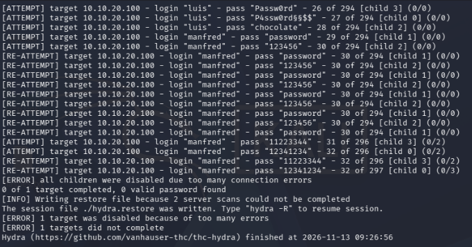
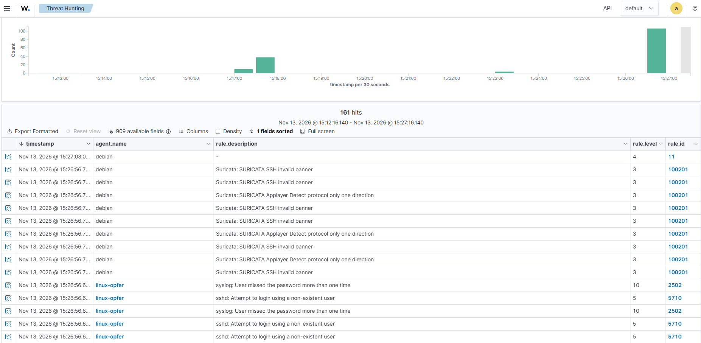
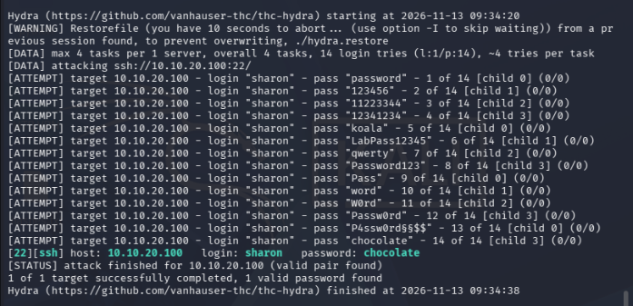
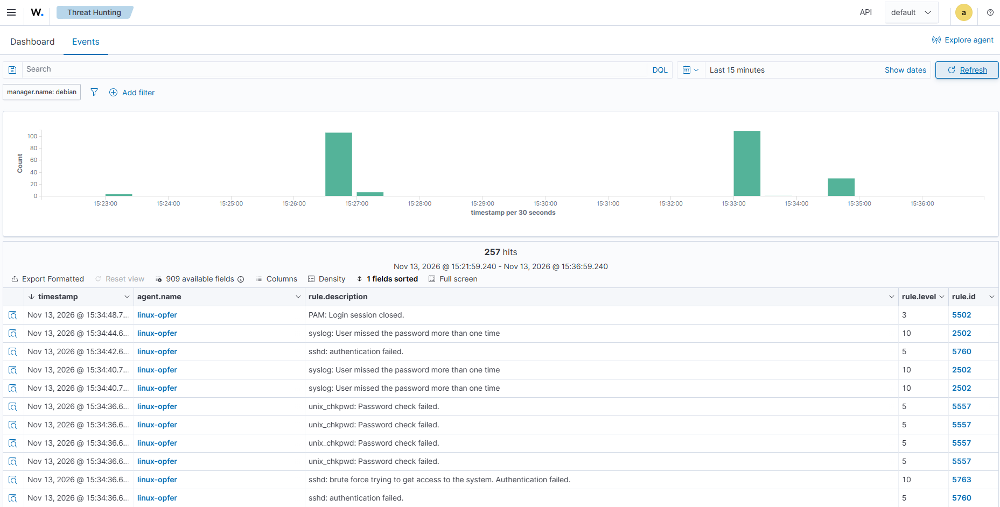
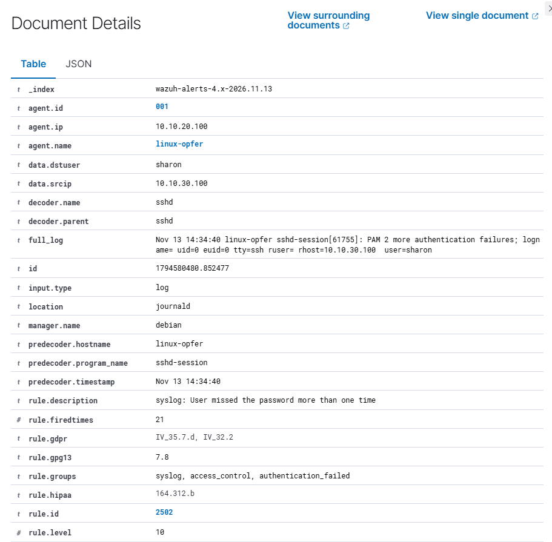
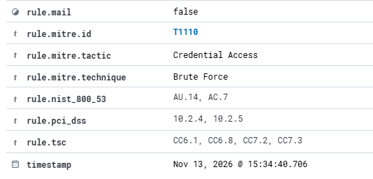
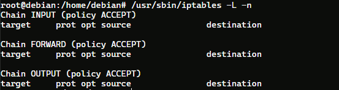
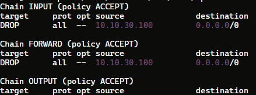
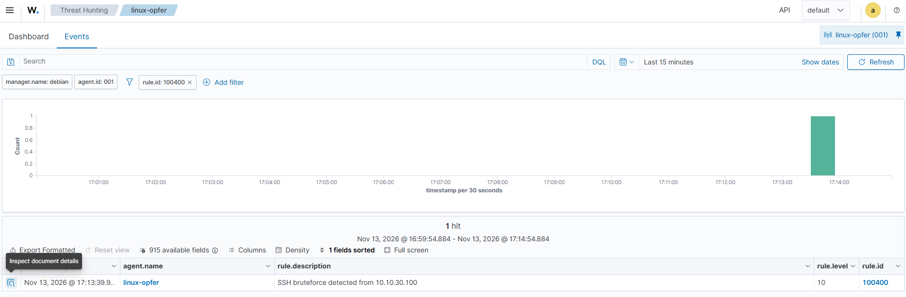

# 08 Szenario 1: SSH-Bruteforce

### Ziel:
Ein Angreifer (Kali) versucht, sich per SSH-Bruteforce Zugang zur Linux-Opfer-VM zu verschaffen. Ich zeige, wie der Angriff abläuft, wie Wazuh und Suricata ihn erkennen, wie OpenSSH sich selbst wehrt und wie Wazuh den Angreifer am Ende per Active Response automatisch sperrt.

 
|||
| **Angreifer** | Kali (10.10.30.100) |
| **Ziel** | linux-opfer (10.10.20.100), SSH |
| **MITRE ATT&CK** | T1110 Brute Force (Taktik Credential Access) |
| **Erkennung** | 5760 → 5763 → eigene Regel 100400 |
| **Reaktion** | Active Response firewall-drop, Sperre für 5 Minuten |

### Vorbereitung auf linux-opfer

Zuerst einen Benutzer für SSH anlegen:

```bash
sudo useradd -m -s /bin/bash sharon
```

- `-m` legt das Home-Verzeichnis an
- `-s /bin/bash` setzt die Login-Shell

Dann ein Passwort setzen:

```bash
sudo passwd sharon
# New password: chocolate
# Retype new password: chocolate
```

Damit sind die Vorbereitungen für den Angriff abgeschlossen, weiter geht es auf der Kali-VM.

### Angriff mit Hydra

Ich zeige zwei Varianten.

**Fall 1: Benutzername und Passwort unbekannt**

Hier kenne ich weder den Benutzernamen noch das Passwort und probiere beide über Wordlists durch. Dafür habe ich mir eine eigene `users.txt` und `pass.txt` fürs Lab angelegt. Einfach aus dem Grund das Bruteforce Attacks sehr viel zeit brauchen und ich den Ablauf im Projekt beschleunigen wollte, verwende ich eigene wordlists, in denen die Usernamen und Passwörter inklusive der Dummys stehen.

```bash
hydra -L users.txt -P pass.txt ssh://10.10.20.100 -t 4 -f -V
```

| Flag | Bedeutung |
|---|---|
| `-L` | Login-Liste (Datei mit Benutzernamen) |
| `-P` | Passwort-Liste (Datei mit Passwörtern) |
| `-t` | Anzahl paralleler Verbindungen (Standard 16) |
| `-f` | Stoppt, sobald ein gültiges Paar gefunden wurde |
| `-V` | Verbose, zeigt jeden einzelnen Versuch |



Der Lauf bricht nach einiger Zeit mit „too many connection errors“ ab. Warum, steht weiter unten unter [OpenSSH wehrt sich selbst](#openssh-wehrt-sich-selbst-persourcepenalties).

Diese Versuche erkenne ich direkt in Wazuh: Sowohl die Suricata-Signatur „SSH invalid banner“ als auch die Host-Regeln aus den sshd-Logs (2502 „User missed the password more than one time“, 5710 „non-existent user“) schlagen an.



**Fall 2: Benutzername per OSINT bekannt**

Realistischer ist der Fall, dass ich den Benutzernamen vorher durch Recherche (OSINT) herausgefunden habe, zum Beispiel dass in der fiktiven Firma eine Person namens „sharon“ im IT-Bereich arbeitet. Das Passwort kenne ich weiterhin nicht, und genau da setze ich an:

```bash
hydra -l sharon -P pass.txt ssh://10.10.20.100 -t 4 -f -V
```

(`-l` klein = ein einzelner Login-Name statt einer Liste)




Hier wird das Passwort `chocolate` gefunden, der Angriff ist erfolgreich.

Auffällig ist: In diesem Fall tauchen meine Suricata-Regeln 100201/100203 **nicht** auf. Das liegt **nicht** an der 16er-Schwelle, denn die gehört zur pfSense-Portscan-Regel 100102 und hat mit den Suricata-Regeln nichts zu tun (100201 feuert bei jedem einzelnen Alert, ganz ohne Schwellwert). Der Grund ist ein anderer: In Fall 1 liefen fast 300 Versuche über viele Verbindungen, dadurch griff die Suricata-Signatur „SSH invalid banner“. In Fall 2 sind es nur 14 Versuche gegen einen User, also deutlich weniger und ruhigerer Verkehr, und die Signatur hat nicht angeschlagen. Die Host-Regel 2502 erkennt den Angriff aber weiterhin zuverlässig.

### OpenSSH wehrt sich selbst (PerSourcePenalties)

Der Abbruch von Hydra in Fall 1 kam **nicht** von einer meiner Regeln, sondern von OpenSSH selbst. Suricata läuft bei mir im IDS-Modus (nur erkennen, nicht blocken), und eine Active Response für SSH hatte ich zu diesem Zeitpunkt noch nicht.

OpenSSH 10 bringt aber eine eingebaute Bremse mit. Das können wir prüfen auf linux-opfer mit:

```bash
ssh -V
sudo sshd -T | grep -iE 'maxstartups|maxauthtries|persourcepenalties'
```

Ergebnis:

```
OpenSSH_10.0p2 Debian-7+deb13u4
maxauthtries 6
maxstartups 10:30:100
persourcemaxstartups none
persourcepenalties crash:90 authfail:5 noauth:1 grace-exceeded:10 refuseconnection:10 max:600 min:15 ...
```

Drei Mechanismen greifen hier:

| Mechanismus | Wirkung |
|---|---|
| `maxstartups 10:30:100` | begrenzt gleichzeitige, noch nicht angemeldete Verbindungen. Ab 10 offenen Pre-Auth-Verbindungen werden neue mit 30 % Wahrscheinlichkeit abgewiesen, ab 100 alle |
| `maxauthtries 6` | nach 6 Fehlversuchen wird die einzelne Verbindung getrennt |
| `persourcepenalties` | sammelt Strafzeiten pro Quell-IP und weist auffällige IPs zeitweise ab |

Entscheidend ist `persourcepenalties`:

- `authfail:5` → jeder Fehlversuch gibt der Angreifer-IP 5 Sekunden Strafe, die sich aufsummieren
- `min:15` → ab 15 Sekunden aufgelaufener Strafe (also nach rund 3 Fehlversuchen) weist sshd neue Verbindungen dieser IP aktiv ab
- `max:600` → die Strafe wächst bei weiteren Fehlschlägen bis maximal 10 Minuten

Genau das hat Hydra in Fall 1 abbrechen lassen: Nach wenigen Fehlversuchen überschritt Kalis Strafzeit die 15-Sekunden-Schwelle, sshd hat neue Verbindungen abgewiesen, und Hydra meldete „too many connection errors“.

> [!IMPORTANT]
> Das ist ein **temporäres** Abweisen (max. 10 Minuten), kein dauerhafter Bann und kein Firewall-Block, und es alarmiert niemanden. Ein geduldiger Angreifer der langsam probiert bleibt unter der Strafschwelle und läuft daran vorbei. Deshalb braucht es für eine dauerhafte protokollierte Sperre zusätzlich fail2ban oder eine eigene Active Response. Das erklärt auch, warum Fall 2 durchkam: nur 14 langsame Versuche gegen einen User, mit `-f` beim Treffer beendet.

### Auswertung in Wazuh (Regel 2502)

Für die Detailansicht filtere ich auf die Host-Regel 2502.




Die wichtigsten Felder für mich als Verteidiger (Blue Team):

| Feld            | Wert                        | Bedeutung                                               |
| --------------- | --------------------------- | ------------------------------------------------------- |
| `agent.ip`      | 10.10.20.100                | welche Maschine betroffen ist                           |
| `agent.name`    | linux-opfer                 | Name der betroffenen Maschine                           |
| `data.dstuser`  | sharon                      | auf welchem Account der Login versucht wurde            |
| `data.srcip`    | 10.10.30.100                | die Angreifer-IP                                        |
| `timestamp`     | Nov 13, 2026 @ 15:34:40.706 | genauer Zeitpunkt des Vorgangs                          |
| `rule.id`       | 2502                        | welche Regel gegriffen hat                              |
| `rule.mitre.id` | T1110                       | MITRE-ATT&CK-ID (Brute Force, Taktik Credential Access) |

Genau diese Punkte brauche ich um Gegenmaßnahmen einzuleiten: Wer greift an (srcip), wen (dstuser), auf welcher Maschine (agent), wann (timestamp) und mit welcher Technik (MITRE T1110).

### Automatische Reaktion (firewall-drop)

Jetzt die letzte Stufe: Der Angriff soll nicht nur erkannt, sondern die Angreifer-IP automatisch gesperrt werden. Dafür nutze ich Wazuhs **Active Response** mit dem eingebauten Skript `firewall-drop`, das auf dem Agent eine iptables-DROP-Regel setzt. Ein eigenes Skript brauche ich hier nicht (anders als beim [VirusTotal-Löschen](07-fim-virustotal-active-response.md)). `host-deny` scheidet aus, weil es über `/etc/hosts.deny` arbeitet, das modernes OpenSSH nicht mehr liest.

**Auslöser finden (Alert-Analyse)**

Zuerst hatte ich eine eigene Frequenz-Regel 100400 mit `if_matched_group authentication_failed` gebaut, die aber nicht ausgelöst hat. Statt lange zu raten, habe ich mir per `tail -f /var/ossec/logs/alerts/alerts.log` angeschaut, was ein Fehlversuch wirklich auslöst:

- **5760** „sshd: authentication failed.“ (Level 5) pro einzelnem Fehlversuch
- **5763** „sshd: brute force trying to get access to the system.“ (**Level 10**), Wazuhs eingebaute Regel, die die Fehlversuche selbst aggregiert und die `srcip` mitbringt

5763 übernimmt die Zählung also schon zuverlässig. Statt selbst zu zählen, hänge ich meine Regel einfach daran.

**Regel 100400 (finale Version)**

In `local_rules.xml`:

```xml
<group name="bruteforce,">

  <rule id="100400" level="10">
    <if_sid>5763</if_sid>
    <description>SSH bruteforce detected from $(srcip)</description>
    <mitre>
      <id>T1110</id>
    </mitre>
  </rule>

</group>
```

Vollständig: [local_rules.xml](../wazuh/local_rules.xml)

`if_sid 5763` heißt: feuere, sobald die eingebaute Bruteforce-Regel anschlägt. `$(srcip)` funktioniert, weil 5763 die IP mitbringt. Wichtig: `frequency`, `timeframe`, `same_srcip` und `ignore` sind hier **verboten**, weil es keine Frequenz-Regel mehr ist, sonst bricht `wazuh-analysisd -t` mit „Invalid use of frequency/context options. Missing if_matched“ ab.

**Active-Response-Block**

Auf dem Wazuh-Server in `ossec.conf` (der `<command name="firewall-drop">`-Block ist schon vordefiniert, nur der folgende Block kommt dazu):

```xml
<active-response>
  <disabled>no</disabled>
  <command>firewall-drop</command>
  <location>defined-agent</location>
  <agent_id>001</agent_id>
  <rules_id>100400</rules_id>
  <timeout>300</timeout>
</active-response>
```

Vollständig: [manager-active-response.xml](../wazuh/ossec-snippets/manager-active-response.xml)

- `location defined-agent` + `agent_id 001`: läuft auf linux-opfer (wo gesperrt werden soll)
- `rules_id 100400`: löst bei meiner Regel aus
- `timeout 300`: Sperre für 5 Minuten, danach entfernt firewall-drop sie automatisch wieder. 

**Test**

Vorher: Die Firewall von linux-opfer ist leer, die Kali-IP ist nicht gesperrt.



Damit der Angriff lange genug läuft, um live gesperrt zu werden, nehme ich eine Wordlist **ohne** das echte Passwort dabei bediene ich mich an einer bekannten Wordlist der rockyou.txt:

```bash
grep -vx chocolate /usr/share/wordlists/rockyou.txt | head -300 > ~/wrong.txt
hydra -l sharon -P ~/wrong.txt ssh://10.10.20.100 -t 4 -V
```

Ergebnis:

1. Im `active-responses.log` feuert Regel 100400, und firewall-drop führt die Reaktion aus (`check_keys` → `continue` → `Ended`) mit der IP 10.10.30.100.
2. Nachher: Auf linux-opfer steht die Sperre in iptables, in der **INPUT-** und der **FORWARD-**Chain:



3. Im Dashboard taucht der Alarm „SSH bruteforce detected from 10.10.30.100“ (Level 10, Regel 100400) auf:



4. Nach 300 Sekunden fällt die Sperre durch den `timeout` von selbst wieder weg.

### Fazit

Szenario 1 zeigt den kompletten Bogen von der Erkennung bis zur Reaktion:

1. **Angriff**: SSH-Bruteforce von Kali
2. **Erkennung**: 5760 pro Fehlversuch → Wazuhs Regel 5763 → eigene Regel 100400 (Level 10, mit Angreifer-IP)
3. **Drosselung** durch OpenSSH selbst (PerSourcePenalties), unabhängig vom SIEM
4. **Reaktion**: firewall-drop sperrt die Angreifer-IP automatisch per iptables
5. **Selbstheilung**: nach 300 Sekunden fällt die Sperre von selbst wieder weg

Wichtig für den Verteidiger: OpenSSHs Drosselung und firewall-drops Sperre sind beide **temporär**. Für eine dauerhafte, protokollierte Sperre würde man in der Praxis zusätzlich fail2ban oder eine Reaktion ohne Timeout einsetzen.

---

Zurück: [07 FIM, VirusTotal und Active Response](07-fim-virustotal-active-response.md) · [Inhaltsverzeichnis](README.md) · Weiter: [09 Szenario 2: Persistenz](09-szenario-2-persistenz.md)
