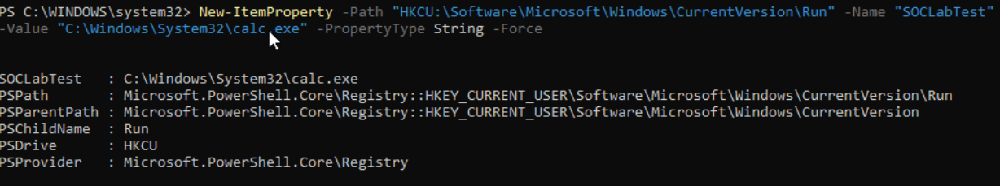
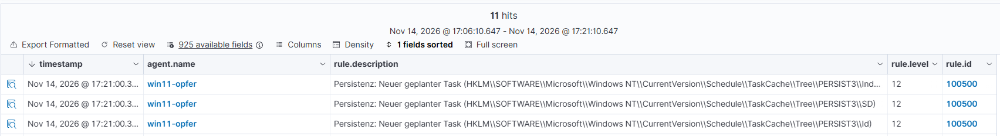
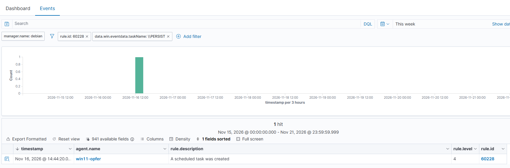
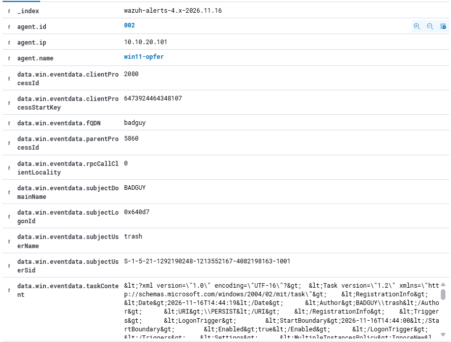
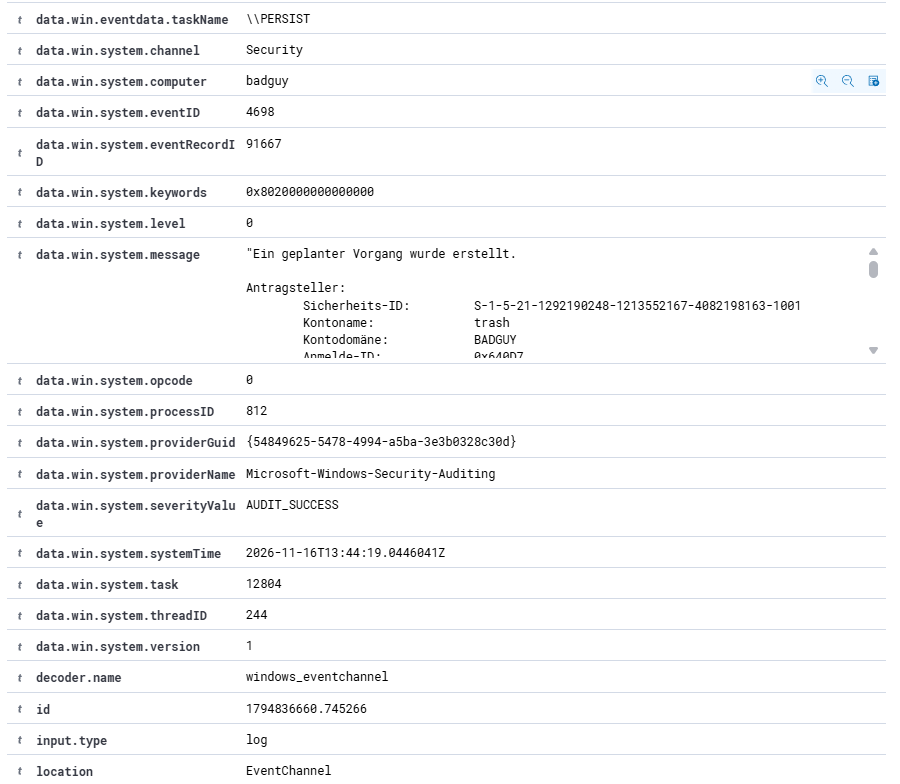

# 09 Szenario 2: Persistenz

### Ziel:
Ein Angreifer legt auf der Windows-Opfer-VM eine geplante Aufgabe an, die bei jeder Anmeldung automatisch startet. Ich zeige, wie die Aufgabe angelegt wird und wie Wazuh das Anlegen erkennt.

| | |
|---|---|
| **Ziel** | win11-opfer |
| **MITRE ATT&CK** | T1053.005 Scheduled Task (Taktik Persistence) |
| **Erkennung** | Windows-Event 4698 → Wazuh-Regel 60228 |
| **Reaktion** | noch keine (geplant: Aufgabe automatisch löschen) |

### Voraussetzung: Auditing einschalten

Damit Windows das Anlegen einer geplanten Aufgabe als Security-Event protokolliert (Event 4698 „A scheduled task was created“), muss das Auditing dafür aktiv sein. Auf win11-opfer:

```powershell
auditpol /set /subcategory:"{0CCE9227-69AE-11D9-BED3-505054503030}" /success:enable /failure:enable
```

GUID statt Name, weil die Unterkategorie auf deutschem Windows anders heißt. Das Security-Log sammelt der Wazuh-Agent bereits ein.

### Angriff: geplante Aufgabe anlegen

Auf win11-opfer lege ich als Angreifer eine Aufgabe an, die bei jeder Anmeldung startet. in dem Szenario gehen wir davon aus das der angreife zugriff auf den Rechner hat und bereits einen Account mit erhöhten rechten hat:

```powershell
schtasks /create /tn "PERSIST" /sc onlogon /tr "cmd.exe /c calc.exe" /f
```

- `/sc onlogon` → Start bei jeder Anmeldung (das ist die Persistenz)
- `/tr` → was ausgeführt wird (hier calc.exe als harmloser Platzhalter für Schadcode)
- `/f` → ohne Rückfrage anlegen bzw. überschreiben

### Erste Versuche: Registry-Run-Key und eigene Sysmon-Regel

Bevor ich bei der geplanten Aufgabe und Event 4698 gelandet bin, habe ich zwei andere Wege ausprobiert.

**Persistenz über den Registry-Run-Key (MITRE T1547.001)**

Programme, die unter `HKCU\Software\Microsoft\Windows\CurrentVersion\Run` eingetragen sind, startet Windows bei jeder Anmeldung des Benutzers automatisch. Das ist eine der bekanntesten Persistenz-Techniken.

```powershell
New-ItemProperty -Path "HKCU:\Software\Microsoft\Windows\CurrentVersion\Run" -Name "SOCLabTest" -Value "C:\Windows\System32\calc.exe" -PropertyType String -Force
```



Auffällig: Die Standard-Konfiguration des Windows-Agents überwacht per FIM nur den Run-Key unter `HKEY_LOCAL_MACHINE`, nicht den unter `HKEY_CURRENT_USER`. Ein Eintrag beim Benutzer fällt darüber also nicht auf. Das eigentliche Szenario baut auf der geplanten Aufgabe auf, den Run-Key habe ich als Alternative getestet.

**Eigene Sysmon-Regel 100500**

Für die geplante Aufgabe habe ich zuerst eine eigene Regel gebaut. Die SwiftOnSecurity-Config von Sysmon markiert Änderungen in der Registry unter `\Schedule\TaskCache\Tree\` mit dem Tag `technique_id=T1053`. Darauf hat meine Regel 100500 reagiert (`if_group windows`, Feld `win.eventdata.ruleName`). Damit Sysmon die Markierung setzt, musste ich die Config vorher mit `sysmon -c` neu laden.



Die Regel hat funktioniert. Dabei fällt aber auf, dass eine einzige Aufgabe gleich drei Alarme auslöst, je einen für `Index`, `SD` und `Id` im Registry-Pfad. Am Ende habe ich die Regel wieder gelöscht und mich für den eingebauten Weg entschieden: Windows schreibt beim Anlegen einer Aufgabe selbst das Event 4698, und Wazuh erkennt es mit Regel 60228, ganz ohne eigene Regel.

### Erkennung in Wazuh (Event 4698)

Beim Anlegen erzeugt Windows das Security-Event **4698** („A scheduled task was created“). Wazuh wertet es über die eingebaute Regel **60228** aus.

**Problem: viele Treffer, die nicht vom Angriff kommen**

Mit dem Filter `rule.id:60228` gab es in einer Woche 27 Treffer, viele davon nachts um 02:11 und 02:41. Das war nicht mein Angriff, sondern vermutlich Windows selbst, das eigene geplante Aufgaben anlegt. Regel 60228 meldet jede neue geplante Aufgabe, egal von wem. Deshalb hat sie auch nur Level 4.

Um meinen Angriff zu finden, filtere ich zusätzlich auf den Namen der Aufgabe:

```
rule.id:60228 and data.win.eventdata.taskName:\\PERSIST
```

Der doppelte Backslash ist richtig: Windows speichert den Namen als `\PERSIST`, im JSON wird der Backslash verdoppelt.

Ergebnis: genau ein Treffer, nämlich mein `schtasks`-Befehl.



**Den Alarm auswerten**




| Frage | Feld | Wert |
| --- | --- | --- |
| Was ist passiert? | `data.win.system.eventID` | 4698, geplanter Vorgang erstellt |
| Wo? | `agent.name` | win11-opfer |
| Welche Aufgabe? | `data.win.eventdata.taskName` | `\PERSIST` |
| Wer hat sie angelegt? | `subjectDomainName` / `subjectUserName` | BADGUY\trash |
| Wann startet sie? | `taskContent` → `LogonTrigger` | bei jeder Anmeldung, das ist die Persistenz |
| Was führt sie aus? | `taskContent` → `Command` / `Arguments` | `cmd.exe /c calc.exe` |
| Mit welchen Rechten? | `taskContent` → `RunLevel` | LeastPrivilege, also ohne Adminrechte |
| MITRE | `rule.mitre.id` | T1053 (Scheduled Task/Job) |

Das Feld `taskContent` enthält die komplette Definition der Aufgabe als XML. Ein Analyst sieht daran sofort, wann sie startet und was sie ausführt, ohne an den Rechner zu müssen.

### Grenzen der eingebauten Regel

- Wazuh ordnet nur die allgemeine Technik T1053 zu, nicht die genauere Unterkategorie T1053.005 (Scheduled Task).
- Level 4 ist niedrig. Eine Aufgabe mit Anmelde-Trigger, die `cmd.exe` startet und von einem normalen Benutzer angelegt wurde, ist deutlich verdächtiger als eine normale Windows-Aufgabe.
- Verbesserung: eine eigene Regel auf 60228, die solche Aufgaben höher bewertet und bekannte Windows-Aufgaben herausfiltert.

> [!NOTE]
> Nächster Schritt: eine automatische Reaktion, die die geplante Aufgabe bei Erkennung löscht.

---

Zurück: [08 Szenario 1: SSH-Bruteforce](08-szenario-1-ssh-bruteforce.md) · [Inhaltsverzeichnis](README.md) · Weiter: [10 Gelöste Probleme](10-geloeste-probleme.md)
